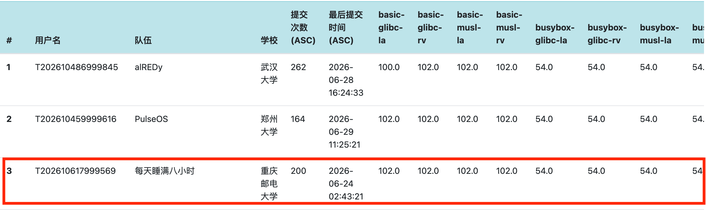
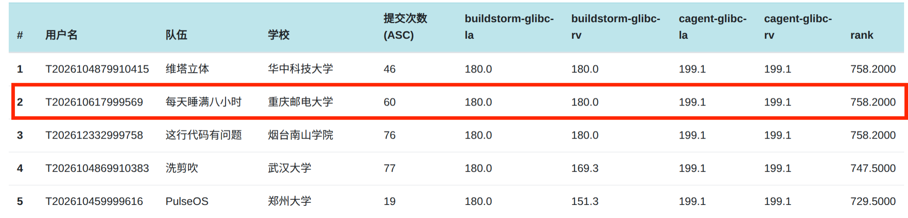

# MossOS

## 项目简介

MossOS 是使用 Rust 实现的 Linux ABI 兼容宏内核，基于 ArceOS 组件化框架并由 StarryOS 演化而来。系统面向操作系统内核功能、性能和跨平台能力验证，内核主体可在 RISC-V64 与 LoongArch64 两种指令集、QEMU 与物理开发板共四个平台间复用。

MossOS 已实现进程与线程、虚拟内存、文件系统、信号、网络、Futex、多核调度和 Linux 系统调用等核心能力，可运行 BusyBox、musl/glibc 用户程序及多类 Linux 应用。平台层提供统一的中断、时钟、串口和设备访问接口，并已接入 VirtIO、SD/MMC、AHCI SATA 和以太网等设备。

## 文档索引

- [文档总入口与复现指引](docs/README.md)

- [决赛设计文档](决赛文档.pdf)
- [BuildStorm 内核设计优化实现文档](BuildStorm内核优化实现文档.pdf)
- [初赛汇报材料](https://pan.baidu.com/s/1Ls1hawu1NluVZ0SAmK7Izg?pwd=moss)（提取码：`moss`，包含演示视频、汇报 PPT 和初赛文档）
- [决赛答辩材料](https://pan.baidu.com/s/1ppQOjb5W-m1yjWBFRqJ3FQ?pwd=moss)（提取码: `moss`,包含答辩视频、答辩 PPT）

## 支持情况

| 平台 | 架构与配置 | 主要硬件路径 | 验证情况 |
| --- | --- | --- | --- |
| QEMU virt | RISC-V64，现场入口 16 核、8 GiB | SBI、PLIC、VirtIO MMIO | DHCP、存储、网络和常用应用已验证 |
| QEMU virt | LoongArch64，现场入口 8 核、8 GiB | EIOINTC、IOCSR IPI、VirtIO PCI | DHCP、存储、网络和常用应用已验证 |
| VisionFive 2 | RISC-V64，4 核、4 GiB | PLIC、UART、SD/MMC、GMAC1 | 完成实板启动、存储、网络和用户程序验证 |
| LS2K1000LA | LoongArch64，2 核、2 GiB | LIOINTC、UART、AHCI SATA、GMAC、RTC | 完成实板启动并通过现场赛测试 |

## 成绩情况

### 初赛线上阶段

截至2026年6月30日，MossOS 以总分 2601.18 位列初赛线上排行榜第 3 名。

<p align="center">
  
</p>

### 决赛线上阶段

截至2026年8月12日，MossOS 以总分 758.2 位列决赛线上排行榜第 2 名。RISC-V64 与 LoongArch64 的 BuildStorm 得分均为 180.0，CAgent 得分均为 199.1。

<p align="center">
  
</p>

## 环境、构建与运行

推荐使用项目比赛镜像，其中已准备 Rust 工具链、交叉编译工具和 QEMU：

```bash
docker run -it --rm --privileged \
  --platform linux/amd64 \
  -v "$(pwd):/work" \
  -w /work \
  docker.io/zhouzhouyi/os-contest:20260510 \
  /bin/bash
```

也可以在仓库根目录直接执行：

```bash
make docker
```

不使用 Docker 时，需要自行安装 Rust nightly、`cargo-binutils`、对应架构的交叉编译工具和 QEMU；LoongArch64 需要 QEMU 10。以下命令均在仓库根目录执行。

### 初赛与决赛 QEMU 内核

```bash
make all
```

该命令按现场使用的 16 GiB 配置生成仓库根目录下的 `kernel-rv` 和 `kernel-la`。两份内核都不固定初赛或决赛脚本，而是在启动时读取设备树中的实际 CPU 数量：单核加载 `src/init_pre.sh`，多核加载 `src/init_final.sh`。因此同一份内核可以通过 QEMU 的 `-smp` 配置切换初赛和决赛入口；正常 QEMU 启动时，可用内存同样以设备树报告为准。

### 现场固定入口

只使用以下四个不带参数的命令：

| 命令 | 作用 | 固定配置与产物 |
| --- | --- | --- |
| `make site-rv` | 编译并自动启动 RISC-V64 QEMU | 16 核、8 GiB，实际加载 `alpine-linux-riscv64-ext4fs.img` |
| `make site-la` | 编译并自动启动 LoongArch64 QEMU | 8 核、8 GiB，实际加载 `sdcard-la-pub.img` |
| `make site-vf2` | 只编译 VisionFive 2 实板镜像 | 4 核、4 GiB，产物 `build/site-vf2/moss-vf2.bin` |
| `make site-2kla` | 只编译 LS2K1000LA 实板镜像 | 2 核、2 GiB，产物 `build/site-2kla/moss-2kla.bin` |

当前 Makefile 的镜像存在性检查仍使用 `images/rootfs/site-rv.img` 和 `site-la.img`，与实际加载路径不一致；本轮尚未修改启动入口，详见[操作指南](docs/guides/README.md)。

QEMU 两个平台都通过内核 DHCP 获得 `10.0.2.15/24`，默认网关为 `10.0.2.2`；进入 Shell 后可以直接使用 `ip addr` 修改地址。固定根文件系统包含 APK、nginx、Redis 和 MariaDB，QEMU 以快照模式运行，不会污染基准镜像。退出 QEMU 时依次按 `Ctrl+A`、`X`。

实板镜像只负责编译，不会自动传输或启动；结合对应开发板的 U-Boot、TFTP 和既有根文件系统手动部署。
