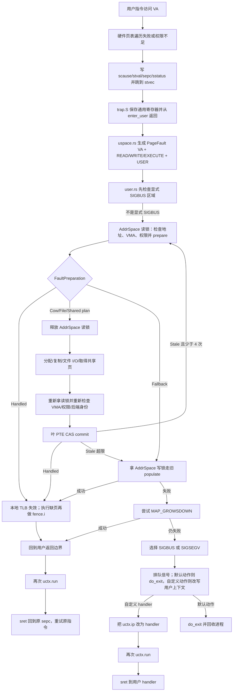

# Moss 当前缺页处理：流程、原理与逐行导读

本文只解释当前工作区中的实际代码，不把设计目标当成已经实现的效果。阅读基准是
2026-07-28 的 `smp-scheduler-optimization` 分支；当前 `HEAD` 是
`3ab5d401322bc12a97d987a8498a84f3d5dec33c`，但缺页、页表、TLB、任务与信号相关文件
还有未提交修改，因此应以本文列出的源码路径和当前工作区内容为准。若以后源码行号
漂移，应优先按函数名定位，再核对本文中的代码片段。

仓库 `Makefile` 第 2 行默认 `ARCH := riscv64`，因此本文把 **RISC-V 64 / Sv39** 作为
完整主链来讲；LoongArch 只在架构行为确有差异处补充。严格说，page fault 是同步
**异常**（exception），不是异步**中断**（interrupt）。下文偶尔沿用口语“缺页中断”，
指的都是这个同步异常。

重点源码：

- `vendor/axcpu/src/riscv/{trap.S,trap.rs,uspace.rs}`：硬件入口、保存/恢复现场，以及把
  RISC-V 异常翻译成缺页原因。
- `vendor/axcpu/src/{trap.rs,uspace_common.rs}`：trap handler 注册表、返回原因与内核
  exception-table fixup。
- `kernel/src/task/user.rs`：用户态缺页的总入口和信号选择。
- `kernel/src/mm/access.rs`：内核访问用户地址时的缺页入口。
- `kernel/src/mm/aspace/mod.rs`：地址检查、两阶段缺页流程、回退路径和 TLB/取指同步。
- `kernel/src/mm/aspace/backend/{mod,file,cow,shared}.rs`：缺页计划及文件映射、私有
  映射、共享匿名映射的实现。
- `vendor/page_table_multiarch/src/bits64.rs`：并发安装或替换 4 KiB PTE。
- `vendor/page_table_entry/src/arch/riscv.rs`：通用权限到 RISC-V PTE 位的转换。
- `kernel/src/mm/tlb.rs`：按当前活跃页表根选择 hart，并通过 SBI RFENCE 做远端
  `SFENCE.VMA`。
- `vendor/axfs/src/highlevel/file.rs`：Moss 当前的每 inode folio 页缓存。

本文先建立全局模型，再逐行读关键代码。为了真的解释到“每一个单词”，后文先统一
解释 Rust 语法词和命名缩写；逐行部分再解释每个本地标识符。这样无需在每一行重复
解释 `let`、`&`、`::` 等相同语法。

## 一、先看完整流程

### 1. 什么是这里的“缺页”

CPU 执行用户程序时，用虚拟地址访问内存。页表项（PTE）可能不存在，也可能存在但
缺少本次访问所需的读、写或执行权限。硬件此时停止当前用户指令，保存现场并进入
内核。Moss 将这次异常表示成：

```text
PageFault(发生访问的虚拟地址, READ/WRITE/EXECUTE | USER)
```

“缺页”不一定表示物理内存不足，也不一定需要磁盘 I/O。当前代码会遇到至少六种情况：

1. 页已经被另一个 CPU 映射，只是本 CPU 仍因旧的 TLB 状态进入了异常。
2. 匿名页或私有文件页尚未分配，需要分配并填零或从文件读取。
3. COW 页存在但只读，本次是写访问，需要复制后换成私有可写页。
4. 共享文件页尚未映射，需要从文件页缓存取得 folio 子页并安装 PTE。
5. 共享匿名页尚未分配，或 PTE 需要增加权限，需要取得共享物理页并安装/更新 PTE。
6. VMA 合法，但后端不支持并发快路径、页大小不是 4 KiB，或竞争次数过多，需要拿
   地址空间写锁走旧 `populate` 路径。

地址不属于有效 VMA、权限不允许，或者文件页装载失败时，这次异常不能被正常修复，
最终会转成 `SIGSEGV` 或 `SIGBUS`。

### 2. 当前主流程



最关键的结构是 `prepare → execute → commit`：

- `prepare` 很短，只在地址空间读锁下观察 VMA、权限和当前 PTE，生成一个计划。
- `execute` 不持有地址空间锁，执行可能很慢的分配、内存复制、文件读取或共享页取得。
- `commit` 重新拿读锁，确认 VMA 和 PTE 没有变，再用原子操作安装结果。
- 如果执行期间另一个线程改了映射，结果叫 `Stale`，不会把旧计划强行写入新映射。
- `Stale` 最多重新从 prepare 开始尝试 4 次；第 5 次仍 stale 才进入独占回退。

### 3. 为什么要分成三段

旧路径 `AddrSpace::handle_page_fault(&mut self, ...)` 需要 `&mut AddrSpace`，调用者必须
持有整个进程地址空间的独占锁。若它在锁内等待块设备，那么同一进程中其他 CPU 即使
缺的是完全不同的页，也不能进入这段代码。

当前 File/COW/Shared 的 4 KiB 快路径把慢操作移出了地址空间锁：

```text
短读锁观察状态 → 无地址空间锁做慢操作 → 短读锁 + PTE CAS 提交
```

这里没有简单地“去掉锁”。地址空间结构仍然需要锁，否则 `munmap`、`mprotect`、
VMA 拆分和缺页提交会互相踩坏。当前做法是缩小保护范围，并用“提交前重新验证”处理
释放锁期间发生的并发变化。

### 4. 当前 folio 是什么

当前 `vendor/axfs/src/highlevel/file.rs` 中的 folio 是 Moss 自己的文件页缓存单位：

- 一个 folio 包含 `2^order` 个连续 4 KiB 基页。
- `MAX_FOLIO_ORDER = 4`，所以当前最大是 16 页，即 64 KiB。
- folio 的起始文件页号按自身大小自然对齐。
- `folio_index` 让 folio 中每个 4 KiB 页号都能查到同一个 `Arc<Folio>`。
- `folio_heads` 为每个 folio 保存一份规范拥有者引用。
- `FolioState.loading` 表示某个任务正在装载；其他任务找到它后等待同一次装载，而不再
  发起一份相同 I/O。
- `FolioPageRef` 固定其中一个 4 KiB 子页，使 PTE 指向它时物理帧不会被页缓存回收掉。

这借用了 Linux `address_space` 和 folio 的核心思想，但不是 Linux folio 子系统的完整
移植。当前没有 Linux XArray、完整的 readahead state、所有 writeback 状态机和内存
回收层级；Moss 使用的是分片 `BTreeMap`、自己的状态位和水位回收。

### 5. 文件映射和 COW 映射分别怎么走

#### 共享文件映射 `FileBackend`

缺少 PTE 时，`prepare_fault` 记录虚拟页和文件页号。`execute` 调
`fault_page_ref(pn)`：

1. 命中缓存就取得现有 folio。
2. 未命中就发布一个 `loading` folio。
3. 发布者读取整个自然对齐 folio；竞争者等待这个 folio 变为 `uptodate`。
4. 返回故障所在的 4 KiB `FolioPageRef`。

`commit_fault` 再验证后把这个子页物理地址写进 PTE，同时把 `FolioPageRef` 放进
`mapped_pages` 固定住它。

对磁盘文件，普通读缺页先映射成只读；写缺页会在有效性保护下标脏并按 VMA 权限映射。
对 tmpfs，`in_memory()` 为真，代码直接使用原始 VMA 权限。

#### 私有映射 `CowBackend`

它覆盖匿名懒分配、`MAP_PRIVATE` 文件映射和 fork 后写时复制：

- 未映射匿名页：无锁阶段分配并清零一个页，提交阶段映射。
- 未映射私有文件读页：优先直接只读映射文件缓存页；第一次写再复制。
- fork 后由多个私有映射共享的匿名页写缺页：额外固定源页，无锁复制，提交时检查 PTE
  仍指向原页后替换；若加临时 pin 后计数恰为 2，说明本来已独占，可免复制加写权限。
- 已映射文件缓存页的写缺页：固定 `FolioPageRef`，无锁复制，提交时原子替换并删除缓存页
  pin。

私有文件读缺页还会以**实际 demand folio 的自然边界和实际页数**为窗口，把同一
folio 的相邻缓存页一并映射为只读；当前最大 folio 是 64 KiB，但实际也可能更小。
必须注意：当前 `fault_page_ref` 会同步等待整个被选中的 folio 装载完成。真正的异步
预读是独立的 `CachedFile::readahead()` 工作者路径，不能把 demand folio load 描述成
异步 I/O。

### 6. 这样做的实际好处

下面只写能由当前代码直接推出的收益：

1. **不同页的慢操作不再被进程级地址空间写锁完全串行化。** File/COW/Shared 4 KiB
   快路径的分配、复制、文件读取或共享帧取得发生在 `AddrSpace` 锁外。
2. **相同文件 folio 的并发缺页合并为一次装载。** 先发布 `loading` folio；后来的
   任务等待它，而不是重复读。
3. **私有文件的首次读可以少一次内存复制。** 完整缓存页以只读方式直接映射，写时再
   COW。
4. **一个 folio（当前最多 64 KiB）内可能减少后续异常和重复存储请求。** demand
   load 得到整个 folio，COW fault-around 会把其中有效且落在 VMA 内的邻页 PTE
   一起装上。
5. **竞争提交不会覆盖胜者。** PTE 通过 compare-and-exchange 安装或条件替换；输掉
   竞争的计划被释放或回退。
6. **页缓存不再固定限制为 256 MiB。** 当前按可用页水位触发回收：低水位约为总页数
   的 1/16、目标约为 1/8，并至少保留 64 MiB 可用内存。
7. **可执行页在修复后有架构同步。** RISC-V 执行 `fence.i`；LoongArch 执行
   `ibar 0`，避免刚生成的 tmpfs 可执行文件立即运行时使用旧取指状态。

这些机制“允许”更多并行，并不自动证明 BuildStorm 一定快多少。性能幅度仍取决于
ext4 锁、块设备队列、调度器、QEMU 翻译速度、Cargo 依赖图和工作负载命中率，需要
运行数据才能量化。

### 7. 当前仍然存在的串行和限制

1. `LinearBackend`、非 4 KiB COW/Shared、特殊 PTE 状态，以及连续 5 次观察到过期计划
   的情况仍走 `Fallback`，持有地址空间独占锁调用旧 `populate`。4 KiB
   `SharedBackend` 现在已经有两阶段并发路径。
2. `prepare` 和 `commit` 仍持有同一进程的地址空间**读锁**。读锁可彼此并发，但会
   与 `mmap/munmap/mprotect` 等写锁互斥。
3. 同一个 PTE 由 CAS 串行决定唯一胜者；这是正确性所需，不是应当消除的全局锁。
4. 同一个 folio 的装载只有一个 loader，其他访问者等待。它消除了重复 I/O，但同一
   folio 的首次访问仍受那次 I/O 延迟约束。
5. `folio_heads` 在发布/删除一个 folio 时是每 inode 的互斥锁；缓存命中的
   `lookup_folio` 不拿它。
6. 每个 4 KiB 子页有自己的 `page_locks[page]`；同一子页的读写会串行，不同子页可
   分开。
7. truncate/破坏性 invalidation 通过每 inode 的 `invalidate_lock` 写侧排除读者；
   普通缺页拿读侧。
8. ext4 元数据和底层块 I/O 仍有自己的锁与等待。folio 只改变文件页缓存与缺页层，
   不能据此声称 ext4 已经完全无全局锁。
9. 共享文件并发快路径只提交故障的一个 4 KiB PTE；它的 demand folio 可以包含邻页，
   但不像 COW fault-around 那样在同一次提交中遍历安装整个窗口。
10. 当前 `SIGBUS_AREAS` 的提前判断只检查记录区域内的**写**缺页，不是完整复刻 Linux
    的所有 mmap `SIGBUS` 语义。

## 二、读代码前的词汇和 Rust 语法

### 1. 内存管理词汇

| 词 | 当前代码中的含义 |
| --- | --- |
| VA / `vaddr` | virtual address，虚拟地址。 |
| PA / `paddr` | physical address，物理地址。 |
| VMA / `area` | 一段连续虚拟地址区域及其权限、后端。Moss 用 `MemoryArea<Backend>` 表示。 |
| PTE | page-table entry，页表项，把虚拟页映射到物理页并带权限。 |
| `pt` | page table，页表对象。 |
| `pn` | page number，文件内以 4 KiB 为单位的页号。 |
| PFN | physical frame number，物理页框号，当前等于 PA/4096。 |
| `flags` | mapping flags，VMA 允许的权限。 |
| `access_flags` | 本次异常所需权限，例如 `WRITE | USER`。 |
| COW | copy-on-write，读时共享，第一次写时复制。 |
| folio | 当前实现中一个含 1～16 个连续 4 KiB 子页的文件缓存对象。 |
| fault-around | 修复当前故障页时，顺便映射附近已经有效的缓存页。 |
| readahead | 预测未来访问并提前把数据送入页缓存；当前另有异步工作队列。 |
| pin | 持有引用，防止某个缓存页仍被 PTE 使用时释放物理帧。 |
| TLB | CPU 对页表翻译结果的缓存。改 PTE 后可能需要失效旧翻译。 |
| hart | RISC-V hardware thread；本文运行环境里基本可按“逻辑 CPU”理解。 |
| CSR | control and status register，RISC-V 控制/状态寄存器。 |
| SBI | Supervisor Binary Interface；S-mode 内核请求 M-mode 固件做远端 fence 等操作的接口。 |
| ASID | address-space identifier，TLB 中区分地址空间的标识；当前 RISC-V 代码使用 0。 |
| CAS | compare-and-swap/exchange，比较相等才原子写入；并发 PTE 提交用它决胜。 |
| shootdown | 通知其他 CPU 失效某地址空间的旧 TLB 翻译。 |
| stale | 计划执行期间映射已变化，计划的观察前提过期。 |

### 2. Rust 语法词

| 写法 | 含义 |
| --- | --- |
| `pub` / `pub(crate)` | 分别向 crate 外公开、只在当前 crate 内公开。 |
| `fn` | 定义函数；函数名通常用动词开头。 |
| `<T>` / `<R>` | 泛型参数；同一实现可代入不同具体类型。 |
| `name: Type` / `-> Type` | 参数或变量的类型标注 / 函数返回类型。 |
| `struct` / `enum` | 定义结构体/枚举。枚举一次只能是其中一个变体。 |
| `impl T` | 为类型 `T` 实现方法。 |
| `self` / `Self` | 当前对象 / 当前类型。 |
| `&T` / `&mut T` | 共享借用 / 独占可修改借用。 |
| `Arc<T>` | 原子引用计数共享所有权，可跨线程持有。 |
| `Weak<T>` | 不增加强引用计数的弱引用；使用前需要 `upgrade()`。 |
| `Option<T>` | `Some(T)` 或 `None`，表示可能存在。 |
| `Result<T, E>` | `Ok(T)` 或 `Err(E)`，表示成功或错误。 |
| `?` | 遇到 `Err`/`None` 就提前返回，否则取出成功值。 |
| `;` | 结束语句并丢弃该表达式值；代码块最后一项无分号时成为块返回值。 |
| `#[...]` | attribute，给下一项附加编译条件、派生、注册或诊断等元信息。 |
| `let` | 创建局部绑定；`let mut` 表示绑定可以修改。 |
| `let Some(x) = y else` | 若 `y` 是 `Some` 就取出 `x`，否则执行 `else`。 |
| `if let` | 只关心一种模式的条件分支。 |
| `match` | 对枚举或模式做完整分支。 |
| `=>` | 模式对应的表达式。 |
| `|` / `|=` | 位或 / 位或后写回，权限位组合用它。闭包参数两侧的 `|x|` 是另一种语法。 |
| `!` | 布尔取反；在宏名后如 `warn!` 表示调用宏。 |
| `::` | 类型、模块或枚举变体的路径分隔，例如 `FaultCommit::Stale`。 |
| `.` | 调用对象方法或访问字段。 |
| `as` | 显式数值或指针类型转换。 |
| `_name` | 前导下划线表示有意暂时不用该参数，避免编译器警告。 |
| `..` | 忽略结构体其余字段；在范围中表示半开区间。 |
| `||` / `&&` | 逻辑或 / 逻辑与，分别短路求值。 |
| `|| { ... }` | 无参数闭包；与逻辑或可由上下文区分。 |
| `move` | 把闭包捕获的所有权移入闭包。 |
| `unsafe` | 编译器无法替程序证明内存/指令安全，调用者在此承担不变量。 |
| `drop(x)` | 立刻结束 `x` 的生命周期，常用于明确提前释放锁。 |

命名约定也很重要：

- `prepare_*` 只观察并准备，不应完成不可回滚的提交。
- `execute` 执行计划里的慢工作。
- `commit_*` 重新验证后发布结果。
- `get_or_publish` 表示“已有就取；没有就尝试成为创建者”。
- `uptodate` 沿用内核术语，表示缓存内容与应读到的文件内容一致且可用。
- `invalidate` 表示使旧缓存或映射失效。

## 三、从硬件异常到 `ReturnReason::PageFault`

### 0. 启动时怎样把硬件入口接起来

这条链不是发生缺页时才临时建立。每个 RISC-V CPU 初始化时，
`vendor/axplat-riscv64-qemu-virt/src/init.rs` 调
`axcpu::init::init_trap()`；后者在 `vendor/axcpu/src/riscv/init.rs:6-16` 做两件事：

```rust
pub fn init_trap() {
    #[cfg(feature = "uspace")]
    crate::uspace_common::init_exception_table();
    unsafe extern "C" {
        fn trap_vector_base();
    }
    unsafe {
        #[cfg(feature = "uspace")]
        riscv::register::sstatus::set_sum();
        crate::asm::write_trap_vector_base(trap_vector_base as usize);
    }
}
```

逐行、逐词解释：

- `pub` 是公开；`fn` 是函数；`init_trap` 是“初始化 trap”；`()`
  表示无参数，省略 `->` 表示返回空值 `()`。
- `#[cfg(feature = "uspace")]` 是编译条件：只有启用用户空间功能才保留下一项。
- `crate::uspace_common::init_exception_table()`：
  `crate` 是当前 `axcpu` crate 根；`::` 是路径分隔；函数把链接器收集的
  `__ex_table` 按故障指令地址排序，供内核用户拷贝失败后的二分查找使用。
- `unsafe extern "C"` 声明一个由汇编提供、采用 C ABI 的外部符号。
  `unsafe` 表示 Rust 编译器不能验证该符号和 ABI；`fn trap_vector_base();` 只有声明，
  函数体在 `trap.S`。
- `sstatus::set_sum()` 设置 RISC-V `sstatus.SUM`，允许 S-mode 在受控代码中访问带
  `U` 位的用户页；它不等于“所有内核代码都可安全解引用用户指针”。
- `trap_vector_base as usize` 把函数符号地址转成机器字整数。
- `write_trap_vector_base` 把地址写入 `stvec`，并把 trap mode 设为 `Direct`。因此所有
  S-mode 可见的中断/异常先跳同一个 `trap_vector_base`，再由软件读 `scause` 分派。

另外，`kernel/src/entry.rs:80,88` 在首个用户地址空间出现前初始化匿名帧引用表，并在
SMP 就绪后调用 `mm::init_tlb_shootdown()`。后者注册页表根切换通知和远端 TLB flush
回调。没有这些初始化，COW 引用计数或跨 CPU 旧翻译的生命周期就不成立。

### 1. `enter_user` 与统一汇编入口：每一行做什么

Rust 的 `UserContext::run()` 并不是普通函数调用后直接在用户态返回。它调用
`vendor/axcpu/src/riscv/trap.S:50-82` 的 `enter_user`：

```asm
.global enter_user
enter_user:
    addi    sp, sp, -16 * XLENB
    STR     s0, sp, 0
    STR     s1, sp, 1
    STR     s2, sp, 2
    STR     s3, sp, 3
    STR     s4, sp, 4
    STR     s5, sp, 5
    STR     s6, sp, 6
    STR     s7, sp, 7
    STR     s8, sp, 8
    STR     s9, sp, 9
    STR     s10, sp, 10
    STR     s11, sp, 11
    STR     ra, sp, 12
    STR     gp, sp, 13
    STR     tp, sp, 14

    STR     sp, a0, 0
    mv      sp, a0
    csrw    sscratch, sp

.Ltrap_return:
    LDR     t0, sp, 32
    LDR     t1, sp, 33
    csrw    sepc, t0
    csrw    sstatus, t1

    POP_GENERAL_REGS
    LDR     sp, sp, 2

    sret
```

先解释汇编里的“单词”：

| 单词/符号 | 含义 |
| --- | --- |
| `.global name` | 把 `name` 导出给链接器，Rust 的 `extern "C"` 才能找到它。 |
| `name:` | 标签；冒号表示这个位置叫 `name`。 |
| `addi rd, rs, imm` | `rd = rs + imm`；这里的 `i` 是 immediate，立即数。 |
| `sp` | stack pointer，RISC-V `x2`。 |
| `ra` | return address，返回地址寄存器 `x1`。 |
| `gp` / `tp` | global pointer / thread pointer。 |
| `s0..s11` | saved registers，按 ABI 由被调用者保存。 |
| `a0` | argument 0；Rust 调用时装着 `&mut UserContext`。 |
| `t0` / `t1` | temporary registers，临时寄存器。 |
| `XLENB` | XLEN in bytes；RV64 中宏定义为 8。 |
| `STR r, base, n` | 本仓库宏；RV64 展开成 `sd r, n*8(base)`，存一个 64 位字。 |
| `LDR r, base, n` | 展开成 `ld r, n*8(base)`，取一个 64 位字。 |
| `mv rd, rs` | move，伪指令，复制寄存器。 |
| `csrw csr, rs` | control/status register write，把 `rs` 写入 CSR。 |
| `sepc` | Supervisor Exception Program Counter，异常返回 PC。 |
| `sstatus` | Supervisor Status，含 SPP、SPIE、SUM 等状态。 |
| `sscratch` | S-mode 软件约定的临时 CSR，这里用来区分 U/S 来源并交换栈。 |
| `POP_GENERAL_REGS` | 用 `LDR` 恢复除 `x0/sp` 外的通用寄存器。 |
| `sret` | Supervisor Return；按 `sstatus.SPP` 回到 U 或 S 模式，并跳到 `sepc`。 |

逐行解释：

- `.global enter_user` 导出符号；`enter_user:` 定义入口。
- `addi sp, sp, -16 * XLENB` 在当前**内核栈**上留出 `16*8=128` 字节。负数使栈向低
  地址增长。
- `STR s0...s11` 十二维持久寄存器每行各存一项；行尾的 `0..11` 是 8 字节槽编号，
  不是字节偏移。
- `STR ra, sp, 12` 保存返回 Rust `UserContext::run()` 的地址。
- `STR gp, sp, 13`、`STR tp, sp, 14` 保存内核全局指针和内核线程指针。第 15 槽只用于
  保持固定帧大小/对齐。
- `STR sp, a0, 0` 把这个内核保存帧的地址写进 `UserContext.regs.zero` 的槽。硬件
  `x0` 永远是零，无需真的保存，所以该槽可临时保存“退出用户态后要恢复的内核 SP”。
- `mv sp, a0` 让 `sp` 指向 `UserContext`；其 `#[repr(C)]` 布局与 `TrapFrame` 完全一致。
- `csrw sscratch, sp` 让 `sscratch` 也指向该 `TrapFrame`。以后用户态 trap 时，硬件
  不会自动换栈，入口第一条指令要靠它找回内核保存区。
- `.Ltrap_return:` 是文件内局部标签；内核 trap 正常返回也会从这里开始。
- `LDR t0, sp, 32` 取 `TrapFrame.sepc`；前 32 个槽是通用寄存器。
- `LDR t1, sp, 33` 取 `TrapFrame.sstatus`。
- 两条 `csrw` 把返回 PC 和特权状态装回硬件 CSR。
- `POP_GENERAL_REGS` 展开成 30 条 `ld`，按 `GeneralRegisters` 的槽恢复
  `ra/gp/tp/t*/s*/a*`。它故意不恢复 `zero` 和 `sp`。
- `LDR sp, sp, 2` 最后从 `regs.sp` 恢复用户栈；必须最后做，否则会失去 TrapFrame
  基址。
- `sret` 进入 U-mode 并执行 `sepc` 指向的用户指令。

用户指令缺页时，硬件完成这些关键动作：把故障指令 PC 写进 `sepc`，把原因
（取指 12、读 13、写 15）写进 `scause`，把故障 VA 写进 `stval`，在 `sstatus.SPP`
记录此前是 U-mode，关闭当前 S-mode 中断使能，然后把 PC 改为 `stvec`。硬件**不会**
把 `sepc` 自动加到下一条，也不会替软件保存 31 个通用寄存器。

于是来到 `trap.S:1-48`：

```asm
.section .text
.balign 4
.global trap_vector_base
trap_vector_base:
    csrrw   sp, sscratch, sp
    bnez    sp, .Ltrap_entry

    csrr    sp, sscratch
    addi    sp, sp, -{trapframe_size}

.Ltrap_entry:
    PUSH_GENERAL_REGS

    csrrw   t0, sscratch, zero
    csrr    t1, sepc
    csrr    t2, sstatus
    STR     t0, sp, 2
    STR     t1, sp, 32
    STR     t2, sp, 33

    andi    t2, t2, 1 << 8
    beqz    t2, .Lexit_user

    mv      a0, sp
    la      ra, .Ltrap_return
    j       riscv_trap_handler

.Lexit_user:
    LDR     sp, sp, 0
    LDR     s0, sp, 0
    LDR     s1, sp, 1
    LDR     s2, sp, 2
    LDR     s3, sp, 3
    LDR     s4, sp, 4
    LDR     s5, sp, 5
    LDR     s6, sp, 6
    LDR     s7, sp, 7
    LDR     s8, sp, 8
    LDR     s9, sp, 9
    LDR     s10, sp, 10
    LDR     s11, sp, 11
    LDR     ra, sp, 12
    LDR     gp, sp, 13
    LDR     tp, sp, 14
    addi    sp, sp, 16 * XLENB
    ret
```

新增汇编词：

| 单词/符号 | 含义 |
| --- | --- |
| `.section .text` | 后续放进可执行代码段。 |
| `.balign 4` | 把下一地址按 4 字节边界对齐。 |
| `csrrw rd, csr, rs` | 原子交换：`rd` 得旧 CSR，CSR 得 `rs`。 |
| `bnez r, label` | branch if not equal zero，非零则跳。 |
| `csrr rd, csr` | 只读 CSR。 |
| `{trapframe_size}` | Rust `global_asm!` 传入的 `size_of::<TrapFrame>()` 常量占位。 |
| `zero` | `x0`；读取恒为 0，写入丢弃。 |
| `andi` | 与立即数按位与。 |
| `1 << 8` | 数值 1 左移 8 位，即 `sstatus.SPP` 掩码。 |
| `beqz` | branch if equal zero，为零则跳。 |
| `la` | load address，把标签地址装进寄存器。 |
| `j` | 无条件跳转，不自动写 `ra`。 |
| `ret` | 返回到 `ra`，伪指令。 |
| `.L...` | 只在本汇编单元内使用的局部标签。 |

逐行解释：

- 三条点指令选择代码段、对齐并导出统一入口；`trap_vector_base:` 是 `stvec` 指向处。
- `csrrw sp, sscratch, sp` 是关键栈交换。
  - 若来自 U-mode：进入前 `sp=用户 SP`、`sscratch=&UserContext`；交换后
    `sp=&UserContext`、`sscratch=用户 SP`。
  - 若来自 S-mode：约定 `sscratch=0`；交换后 `sp=0`、`sscratch=原内核 SP`。
- `bnez sp, .Ltrap_entry`：来自 U-mode 时新 `sp` 非零，已经有现成 UserContext，
  直接保存；来自 S-mode 时为零，继续两行建立内核 TrapFrame。
- `csrr sp, sscratch` 取回原内核 SP；`addi ... -trapframe_size` 在内核栈分配
  TrapFrame。花括号不是运行时语法，汇编前已替成 Rust 类型大小。
- `PUSH_GENERAL_REGS` 展开成逐个 `sd`。它不存 `zero/sp`，稍后单独填 `sp`。
- `csrrw t0, sscratch, zero` 把交换时留在 `sscratch` 的原 SP 取到 `t0`，同时把
  `sscratch` 清零，恢复“S-mode 正常运行时为 0”的约定。
- 两条 `csrr` 分别读取故障 PC 和状态。
- 三条 `STR` 把原 SP、`sepc`、`sstatus` 放到与 Rust `TrapFrame` 字段一致的槽。
- `andi t2, t2, 1 << 8` 只保留 SPP；SPP=1 表示 trap 前在 S-mode，SPP=0 表示此前在
  U-mode。
- `beqz t2, .Lexit_user`：用户态 trap 不在汇编里调用 `riscv_trap_handler`，而是返回
  `UserContext::run()`，由任务循环处理可能睡眠的用户缺页。
- S-mode 路径中，`mv a0, sp` 按 C ABI 传 `&mut TrapFrame`；
  `la ra, .Ltrap_return` 手工指定 Rust handler 返回后的落点；
  `j riscv_trap_handler` 跳到内核 trap 分派。
- `.Lexit_user` 的第一行 `LDR sp, sp, 0` 从 UserContext 的 `regs.zero` 槽取回前面
  `enter_user` 保存的内核栈帧地址。
- 随后 `LDR s0..s11` 每行恢复一个内核被调用者保存寄存器；`ra/gp/tp` 三行恢复 Rust
  返回地址、全局指针、线程指针。
- `addi sp, sp, 16 * XLENB` 释放 128 字节内核保存帧。
- `ret` 回到 `unsafe { enter_user(self) }` 的下一行。此时用户寄存器现场仍保存在
  `UserContext` 内，`scause/stval` 仍可由 Rust 读取。

这一段回答了一个常见疑问：**用户缺页没有先进入
`vendor/axcpu/src/riscv/trap.rs::riscv_trap_handler`。** 它从统一汇编入口直接退回
`UserContext::run()`；只有 S-mode 缺页才进入 Rust 的 `riscv_trap_handler`。

### 2. RISC-V 用户态返回原因

当前代码在 `vendor/axcpu/src/riscv/uspace.rs:53-92`。前六行把汇编接进来：

```rust
pub fn run(&mut self) -> ReturnReason {
    extern "C" {
        fn enter_user(uctx: &mut UserContext);
    }

    crate::asm::disable_irqs();
    unsafe { enter_user(self) };
```

- `pub fn run`：公开的“运行这份用户上下文”方法。
- `&mut self`：调用者独占借用上下文，因为 trap 会把用户寄存器写回其中。
- `-> ReturnReason`：回来后不直接处理一切，而是把原因交给内核任务循环。
- 内层 `extern "C"` 声明上一节的汇编函数；参数名 `uctx` 是 user context 缩写。
- `disable_irqs()` 清 `sstatus.SIE`。从保存内核现场、切换用户现场到 `sret` 之间不能让
  普通 S-mode 中断看见半切换状态。
- `unsafe { enter_user(self) }`：`self` 自动从 `&mut UserContext` 作为 `a0` 传入；
  `unsafe` 承认这次汇编调用会切特权级并按约定改写上下文。
- 行末分号表示忽略汇编函数的直接返回值；真正原因在 CSR 中。

汇编因 trap 返回后继续：

```rust
let scause = scause::read();
let ret = if let Ok(cause) = scause.cause().try_into::<I, E>() {
    let stval = stval::read();
    match cause {
        Trap::Interrupt(_) => {
            handle_trap!(IRQ, scause.bits());
            ReturnReason::Interrupt
        }
        Trap::Exception(E::UserEnvCall) => {
            self.sepc += 4;
            ReturnReason::Syscall
        }
        Trap::Exception(E::LoadPageFault) => {
            ReturnReason::PageFault(va!(stval), PageFaultFlags::READ | PageFaultFlags::USER)
        }
        Trap::Exception(E::StorePageFault) => ReturnReason::PageFault(
            va!(stval),
            PageFaultFlags::WRITE | PageFaultFlags::USER,
        ),
        Trap::Exception(E::InstructionPageFault) => ReturnReason::PageFault(
            va!(stval),
            PageFaultFlags::EXECUTE | PageFaultFlags::USER,
        ),
        Trap::Exception(e) => ReturnReason::Exception(ExceptionInfo { e, stval }),
    }
} else {
    ReturnReason::Unknown
};
crate::asm::enable_irqs();
ret
```

逐行解释：

- `let scause = scause::read();`：`scause` 是 RISC-V supervisor cause CSR；模块名和局部
  变量同名。`read` 读出硬件记录的异常/中断原因。
- `let ret = if let Ok(cause) = ...`：最终返回值绑定为 `ret`。`cause()` 取原因位，
  `try_into::<I, E>()` 尝试解成中断枚举 `I` 或异常枚举 `E`；成功时取出 `cause`。
- `let stval = stval::read();`：`stval` 是 trap value CSR；页异常时保存故障虚拟地址。
- `match cause`：按硬件原因分派。
- `Trap::Interrupt(_)`：任意中断；`_` 表示这里不需要具体中断值。
- `handle_trap!(IRQ, scause.bits())`：把原始原因位交给已注册 IRQ 处理器。
- `ReturnReason::Interrupt`：告诉上层本次返回用户态的原因是中断。
- `E::UserEnvCall`：用户执行 `ecall`；`self.sepc += 4` 跳过 4 字节系统调用指令，否则
  返回用户态会再次执行它；随后返回 `Syscall`。
- `E::LoadPageFault`：读/加载缺页；`va!(stval)` 把整数包装成 `VirtAddr`；
  `READ | USER` 同时说明访问类型和特权来源。
- `E::StorePageFault`：写/存储缺页，生成 `WRITE | USER`。
- `E::InstructionPageFault`：取指缺页，生成 `EXECUTE | USER`。
- 三种页异常都**没有**修改 `self.sepc`。这是有意的：处理成功后必须重试原故障指令。
  与它对照，`ecall` 明确执行 `self.sepc += 4`，因为系统调用不能重复执行。
- `E::Exception(e)`：其他已知异常，把具体异常 `e` 和附加值 `stval` 交给通用异常路径。
- `else ReturnReason::Unknown`：原因位无法解码时返回未知。
- `enable_irqs()`：用户运行函数进入时关闭了中断；回到 Rust 上层前恢复。
- 最后一行 `ret` 没有分号，所以是函数返回表达式。

`ReturnReason::PageFault(VirtAddr, PageFaultFlags)` 是一个带两个匿名字段的 enum 变体：
第一个字段回答“哪里 fault”，第二个回答“什么访问 fault”。它不携带
`NotMapped/PermissionDenied` 分类，因为 RISC-V 的三种 page-fault cause 主要按
load/store/fetch 区分；软件随后查 VMA 和 PTE 才知道究竟是缺项、COW 写保护还是非法
权限。

### 3. LoongArch 用户态入口

`vendor/axcpu/src/loongarch64/uspace.rs:48-79` 做同一件事：

```rust
let estat = estat::read();
let badv = badv::read().vaddr();
let badi = badi::read().inst();

let ret = match estat.cause() {
    Trap::Interrupt(_) => { /* IRQ */ }
    Trap::Exception(Exception::Syscall) => { /* syscall */ }
    Trap::Exception(Exception::LoadPageFault)
    | Trap::Exception(Exception::PageNonReadableFault) => {
        ReturnReason::PageFault(va!(badv), PageFaultFlags::READ | PageFaultFlags::USER)
    }
    Trap::Exception(Exception::StorePageFault)
    | Trap::Exception(Exception::PageModifyFault) => {
        ReturnReason::PageFault(va!(badv), PageFaultFlags::WRITE | PageFaultFlags::USER)
    }
    Trap::Exception(Exception::FetchPageFault)
    | Trap::Exception(Exception::PageNonExecutableFault) => {
        ReturnReason::PageFault(va!(badv), PageFaultFlags::EXECUTE | PageFaultFlags::USER)
    }
    Trap::Exception(e) => ReturnReason::Exception(ExceptionInfo { e, badv, badi }),
    _ => ReturnReason::Unknown,
};
```

- `estat` 是异常状态寄存器；`cause()` 取异常原因。
- `badv` 是 bad virtual address，`vaddr()` 取故障虚拟地址。
- `badi` 是 bad instruction，`inst()` 取导致异常的指令编码，供其他异常诊断使用。
- LoongArch 把“不存在”和“存在但不可读/不可写/不可执行”分成不同异常，所以每类用
  `|` 模式合并：
  - `LoadPageFault | PageNonReadableFault` 都是 `READ`。
  - `StorePageFault | PageModifyFault` 都是 `WRITE`。
  - `FetchPageFault | PageNonExecutableFault` 都是 `EXECUTE`。
- 此处模式之间的单个 `|` 是“或模式”，不是权限位或；右侧
  `PageFaultFlags::READ | PageFaultFlags::USER` 才是位或。

`PageFaultFlags` 并非另一套类型。`vendor/axcpu/src/trap.rs:8` 用
`pub use page_table_entry::MappingFlags as PageFaultFlags;` 给 `MappingFlags` 起了一个
语义别名，所以异常访问位和 VMA/PTE 权限位能直接用 `contains` 比较。

## 四、用户任务总入口

核心是 `kernel/src/task/user.rs:52-127`。外层骨架先做：

```rust
let thr = curr.as_thread();
while !thr.pending_exit() {
    ptrace_wait_if_stopped(thr);
    let reason = uctx.run();
    let interrupted = matches!(reason, ReturnReason::Interrupt);
    set_timer_state(&curr, TimerState::Kernel);
    /* execve 要求退出的检查 */
    match reason {
        /* ... */
    }
```

- `curr` 是当前调度任务；`as_thread()` 取得 Moss 用户线程扩展。
- `while !thr.pending_exit()`：只要线程未被标成退出就循环。`!` 取反。
- `ptrace_wait_if_stopped`：若调试器把线程停住，先等待继续；它不是缺页修复本身。
- `uctx.run()` 经上一节的 `sret → trap → ret` 往返一次，得到 `reason`。
- `matches!` 是只返回布尔值的模式宏；这里只记录本次是否被中断打断，供后面的 rseq
  用户返回准备使用。
- trap 已进入内核，所以计时状态从 User 切为 Kernel。

缺页分支的结构是：

```rust
match reason {
    ReturnReason::Syscall => handle_syscall(&mut uctx),
    ReturnReason::PageFault(addr, flags) => {
        let fault_signal = {
            let aspace_ref = thr.proc_data.aspace();
            if is_mmap_sigbus_fault(...) {
                Some(Signo::SIGBUS)
            } else if AddrSpace::handle_page_fault_concurrent(&aspace_ref, addr, flags) {
                None
            } else {
                let mut aspace =
                    aspace_ref.lock_profiled(AddrSpaceWriteOwner::Other);
                if try_growdown_fault(...) {
                    None
                } else {
                    let signo = if aspace.is_accessible_fault(addr, flags) {
                        Signo::SIGBUS
                    } else {
                        Signo::SIGSEGV
                    };
                    /* 记录地址、指令和栈映射 */
                    Some(signo)
                }
            }
        };
        if let Some(signo) = fault_signal {
            /* 记录并投递致命信号 */
        }
    }
    /* 其他 ReturnReason */
}
```

逐行、逐标识符解释：

- `match reason`：`reason` 是 `uctx.run()` 返回的 `ReturnReason`，这里做完整分类。
- `ReturnReason::Syscall => handle_syscall(&mut uctx)`：系统调用分支把可修改的用户上下文
  传给系统调用处理器，以便读取参数和写回返回值。
- `ReturnReason::PageFault(addr, flags)`：模式同时取出 `addr`（故障 VA）和 `flags`
  （本次访问位）。
- `let fault_signal = { ... };`：这个代码块最终产生 `Option<Signo>`。`None` 表示缺页已经
  修复；`Some` 表示需要投递信号。
- `let aspace_ref = thr.proc_data.aspace();`：
  - `thr` 是当前线程。
  - `proc_data` 是线程所属进程数据。
  - `aspace()` 返回共享的 `Arc<AddrSpaceLock>`。
  - 名字加 `_ref` 强调这是共享引用，不是已经取得的锁 guard。
- `is_mmap_sigbus_fault(pid, addr, flags)`：先查 mmap 层显式记录的 `SIGBUS_AREAS`。当前
  实现只在 `flags` 包含 `WRITE` 且地址落入该进程记录区间时返回真。
- `Some(Signo::SIGBUS)`：无需尝试填页，直接选择总线错误。
- `else if AddrSpace::handle_page_fault_concurrent(...)`：调用当前并发缺页主路径。返回
  `true` 表示可以重试原指令。
- `None`：成功时不投递信号。
- `let mut aspace = aspace_ref.lock_profiled(AddrSpaceWriteOwner::Other);`：主路径失败后
  取得地址空间**写锁**。`lock_profiled` 除拿锁外还在启用 guest profile 时记录持锁
  时间；`Other` 是这次持锁的归因标签。`mut` 是因为 grow-down 会修改 VMA/页表。
- `try_growdown_fault(pid, &mut aspace, addr, flags)`：如果地址位于记录的向下增长区间，
  为对齐后的 4 KiB 页建立匿名 COW 区域。成功也返回 `None`。
- `aspace.is_accessible_fault(addr, flags)`：重新查 VMA；如果地址属于一个包含本次访问
  权限的区域，说明映射合法但后端填页失败，代码选择 `SIGBUS`；否则选 `SIGSEGV`。
- 三次 `log_user_fault_mapping`：分别记录故障地址、当前指令地址 `uctx.ip()` 和栈指针
  `uctx.sp()` 所在映射，仅用于诊断，不参与修复。
- `Some(signo)`：把选择的信号带出代码块。
- `if let Some(signo) = fault_signal`：只有失败时进入。
- `warn!`：打印进程、信号、地址、访问位、IP、SP。
- `raise_signal_fatal(SignalInfo::new_kernel(signo))`：
  - `SignalInfo::new_kernel` 标记信号由内核生成。
  - `raise_signal_fatal` 向**当前进程**排队这个 fault signal；函数名里的 `fatal`
    表示该路径不能忽略投递失败后继续原指令，不表示此函数调用点必然同步销毁进程。
- `.expect("Failed to send fault signal")`：如果连信号投递都失败，内核在此 panic，而不是
  静默继续执行错误地址。

`try_growdown_fault` 自己的最终动作也要看清：

```rust
let page = addr.align_down_4k().as_usize();
let mut areas = GROW_DOWN_AREAS.lock();
let Some(area) = areas
    .iter_mut()
    .find(|it| it.pid == pid && page >= it.low && page < it.high)
else {
    return false;
};
if area.blocked {
    return false;
}
let mut flags = MappingFlags::READ | MappingFlags::WRITE | MappingFlags::USER;
if access_flags.contains(MappingFlags::EXECUTE) {
    flags |= MappingFlags::EXECUTE;
}
aspace
    .map(
        VirtAddr::from_usize(page),
        PageSize::Size4K as usize,
        flags,
        true,
        Backend::new_alloc(VirtAddr::from_usize(page), PageSize::Size4K),
    )
    .is_ok()
```

- `align_down_4k` 把页内任意 fault VA 变成页首。
- `GROW_DOWN_AREAS` 是全局 `Mutex<Vec<GrowdownArea>>`；`iter_mut().find` 要求 PID
  相同且 `low <= page < high`。比较是半开区间。
- `blocked` 表示后来固定映射与这段增长保留区冲突，不能再长。
- 新页固定给 `READ|WRITE|USER`；只有执行 fault 才额外给 `EXECUTE`。
- `map` 的 `populate=true`，所以不只创建 VMA 元数据，还立即让后端为这个 4 KiB 区域
  建 PTE。
- `Backend::new_alloc` 创建匿名 COW 后端；`is_ok()` 丢弃具体成功值/错误，只返回 bool。

提前 `is_mmap_sigbus_fault` 则只判断“本次含 WRITE，且 PID/地址落入
`SIGBUS_AREAS`”。这些区域由当前 `mremap` 扩展旧共享文件映射的兼容逻辑登记，并非
Linux 所有 mmap-SIGBUS 规则的完整实现。

`kernel/src/task/signal.rs:193-208` 的投递本体是：

```rust
pub fn raise_signal_fatal(sig: SignalInfo) -> AxResult<()> {
    let curr = current();
    let proc_data = &curr.as_thread().proc_data;
    let signo = sig.signo();
    if let Some(tid) = proc_data.signal.send_signal(sig)
        && let Ok(task) = get_task(tid)
    {
        task.interrupt();
    } else {
        do_exit(signo as i32, true);
    }
    Ok(())
}
```

- `sig: SignalInfo` 按值传入；`sig.signo()` 在移动 `sig` 前保存编号。
- `proc_data.signal.send_signal(sig)` 把信号放入进程 pending 队列，并尝试选择一个可被
  唤醒的线程，成功返回 `Some(tid)`。
- `if let ... && let ...` 是 let-chain：既要有线程 ID，又要能从任务表找到它。
- `task.interrupt()` 唤醒/打断目标，让它尽快走用户返回信号检查。
- 任一 let 失败都进 `else`，以 `group_exit=true` 直接执行 `do_exit`；因此这个
  “fatal” 入口不会因没有可接收线程而静默留下故障进程。
- `signo as i32` 把 `Signo` 枚举判别值转为退出码。
- `Ok(())` 表示投递动作本身完成；它不表示用户故障地址已经变得可访问。

`match` 结束并不立刻执行 `sret`。`user.rs:175-202` 还会：

1. 若 `do_exit()` 已回收地址空间，立刻 `break`，不再碰任何用户内存。
2. 做一次用户返回边界的调度再平衡和 rseq 准备。
3. `while check_signals(...) {}` 取出可投递信号。
4. 没有退出时把计时状态切回 User，清当前任务的中断标志。
5. 回到 `while` 顶部，再次调用 `uctx.run()`。

因此成功缺页的“最后一跳”是：上下文的 `sepc` 仍等于故障 PC，再次
`enter_user → sret` 后，CPU **重试原指令**。grow-down 成功也走同一结局。

失败信号则有两种真正落点：

- 若用户安装了 `SIGSEGV/SIGBUS` handler，`starry-signal` 在用户栈写入
  `SignalFrame`，把 `uctx.ip` 改成 handler，把 `a0/a1/a2` 设为信号参数，把 `ra`
  设为 restorer；下一次 `sret` 到达用户 handler，而不是故障 PC。handler 若
  `sigreturn`，旧上下文会恢复；若它不修正原因，恢复后会再次在同一指令缺页。
- 默认 disposition 下，两者的默认动作都是 `CoreDump`。`check_signals` 调
  `do_exit((signo as i32) | 0x80, true)`；这里的 `0x80` 记录 core-dump 风格退出状态，
  当前这条链并没有展示实际写出 core 文件。`do_exit` 退出线程组、回收最后一个线程的
  地址空间/文件等资源，设置 `pending_exit`，最终跳出用户循环。

## 五、内核访问用户内存时的入口

内核不能把任意 S-mode page fault 都当成用户懒页。允许窗口由
`kernel/src/mm/access.rs:27-44` 显式打开：

```rust
#[track_caller]
pub fn access_user_memory<R>(f: impl FnOnce() -> R) -> R {
    let curr = current();
    let Some(thr) = curr.try_as_thread() else {
        panic!(/* outside of thread context */);
    };
    thr.set_accessing_user_memory(true);
    let result = f();
    thr.set_accessing_user_memory(false);
    result
}
```

- `#[track_caller]` 让函数内 panic 报告调用者位置。
- `<R>` 声明泛型返回类型；`f: impl FnOnce() -> R` 接受一个只能调用一次、返回 `R`
  的闭包；外层函数也原样返回 `R`。
- `try_as_thread` 失败表示当前是纯内核任务/无用户进程地址空间，此时调用本 API 是
  编程错误，所以 panic。
- `set_accessing_user_memory(true/false)` 在当前线程对象上打开/关闭布尔门。
- `let result = f()` 期间发生的 S-mode page fault 才允许落到进程地址空间 handler。
- 最后一行无分号，返回闭包结果。这里不是 RAII guard；正常返回会复位，panic 本身不会
  继续正常内核执行。

`kernel/src/mm/access.rs:46-69` 在正式复制前预检查整个区域：

```rust
fn check_region(start: VirtAddr, layout: Layout, access_flags: MappingFlags) -> AxResult<()> {
    let align = layout.align();
    if start.as_usize() & (align - 1) != 0 {
        return Err(AxError::BadAddress);
    }
    let curr = current();
    let aspace_ref = curr.as_thread().proc_data.aspace();
    if !aspace_ref.read().can_access_range(start, layout.size(), access_flags) {
        return Err(AxError::BadAddress);
    }
    let page_start = start.align_down_4k();
    let page_end = (start + layout.size()).align_up_4k();
    for page in PageIter4K::new(page_start, page_end).ok_or(AxError::BadAddress)? {
        if !AddrSpace::populate_page_concurrent(&aspace_ref, page, access_flags) {
            return Err(AxError::BadAddress);
        }
    }
    Ok(())
}
```

- `layout` 同时携带对象大小和对齐要求。
- `start.as_usize() & (align - 1)` 取地址在二次幂对齐中的低位；非零即未对齐。
- `can_access_range` 在读锁下确认整个范围被 VMA 覆盖且权限足够。
- `align_down_4k` 和 `align_up_4k` 把任意字节范围扩到覆盖它的完整页范围。
- `PageIter4K::new` 创建逐 4 KiB 页迭代器；构造失败转成 `BadAddress`。
- `populate_page_concurrent` 与用户异常走同一内部机制，但传
  `flush_existing = false`：这是主动预填，不是本 CPU 已经缓存无效翻译后重试异常。

若预检查和实际复制之间仍发生缺页，`access.rs:272-287` 注册的内核 trap handler 兜底：

```rust
#[register_trap_handler(PAGE_FAULT)]
fn handle_page_fault(vaddr: VirtAddr, access_flags: MappingFlags) -> bool {
    let curr = current();
    let Some(thr) = curr.try_as_thread() else { return false; };
    if unlikely(!thr.is_accessing_user_memory()) { return false; }
    let aspace = thr.proc_data.aspace();
    AddrSpace::handle_page_fault_concurrent(&aspace, vaddr, access_flags)
}
```

- 属性宏把函数放进 `PAGE_FAULT` 分布式 handler 列表。
- `try_as_thread` 防止在非普通用户线程上下文误处理。
- `is_accessing_user_memory` 只在受保护的用户复制区间为真；否则内核缺页不应被当成
  用户懒分配掩盖。
- `unlikely` 是分支预测提示，不改变语义。

架构内核 trap 再包了一层。RISC-V 从 `stval` 取地址后调用注册的 `PAGE_FAULT`
handler；若没人处理且 exception fixup 也失败才 panic。LoongArch 还创建
`KernelPageFaultIrqGuard`：异常入口默认清中断使能，但当前缺页路径可能睡眠、被抢占或
参加跨 CPU TLB shootdown，所以 guard 按保存的 `tf.prmd` 暂时恢复异常前的中断状态，
调用 handler 后再关闭中断，交给汇编返回路径。这个 guard 只围绕内核态 trap；用户态
`UserContext::run` 返回 Rust 循环后走的是前文的 `ReturnReason` 路径。

把 RISC-V 这层完整展开，`vendor/axcpu/src/riscv/trap.rs:21-38` 是：

```rust
fn handle_page_fault(tf: &mut TrapFrame, access_flags: PageFaultFlags) {
    let vaddr = va!(stval::read());
    if handle_trap!(PAGE_FAULT, vaddr, access_flags) {
        return;
    }
    #[cfg(feature = "uspace")]
    if tf.fixup_exception() {
        return;
    }
    panic!(/* Unhandled Supervisor Page Fault ... */);
}
```

- `tf` 是汇编刚保存在内核栈上的 trap frame；`&mut` 允许 fixup 改 `sepc`。
- `va!` 把 `stval` 的机器字包装为 `VirtAddr`。
- `handle_trap!` 不是硬件指令，是 `vendor/axcpu/src/trap.rs:36-48` 的 Rust 宏：
  它遍历 `PAGE_FAULT` 分布式 slice，取第一个已注册函数并以
  `(vaddr, access_flags)` 调用。多个 handler 会警告但只调第一个；一个也没有则警告并
  返回 `false`。
- `PAGE_FAULT` 的元素类型是 `fn(VirtAddr, PageFaultFlags) -> bool`；尾部 `bool`
  就是“我能否让故障指令安全重试”。
- `#[register_trap_handler(PAGE_FAULT)]` 把 `kernel/src/mm/access.rs` 的
  `handle_page_fault` 静态加入该 slice。属性方括号不是运行时调用。
- handler 返回 `true` 时，这里裸 `return;`。`return` 没值，因为函数返回 `()`；
  随后 `riscv_trap_handler` 返回汇编 `.Ltrap_return`，最终 `sret` 到原 S-mode
  `sepc`，重试刚才的 load/store。
- `#[cfg(feature = "uspace")]` 后的 fixup 只在 handler 没解决时尝试。
- `panic!` 是最后防线：既不是允许的用户内存访问，也没有 exception-table 恢复点的
  S-mode 缺页被视为内核 bug/不可恢复故障。

上层分派 `riscv_trap_handler` 把三种 `scause` 分别转为纯
`READ`、`WRITE`、`EXECUTE`。注意这里**没有 `USER` 位**，因为 trap 前是 S-mode；
这也使 `area.flags().contains(access_flags)` 只检查这次数据权限，而不会伪称访问来自
U-mode。

exception fixup 链专门保证 `user_copy` 可以把坏用户指针变成错误码：

1. `vendor/axcpu/src/riscv/user_copy.S` 的每条可能故障的 `LDR/STR/LB/SB` 都通过
   `fixup` 宏发出。
2. `fixup` 除生成真实 load/store，还用 `_asm_extable 100b, .Lerr_copy_user` 在
   `__ex_table` 段记录“故障指令地址 → 恢复标签地址”。`100b` 中 `b` 是 backward，
   指向前面最近的数字标签 `100:`。
3. 链接脚本把所有记录放在 `_ex_table_start.._ex_table_end`；启动时已排序。
4. `tf.fixup_exception()` 以当前 `tf.ip()` 二分查表；命中后
   `tf.set_ip(entries[entry].to)`，也就是把 `sepc` 改成 `.Lerr_copy_user`。
5. `sret` 不再重试坏 load/store，而从 `.Lerr_copy_user` 执行
   `sub a0, t5, a0; ret`，返回尚未复制的字节数。
6. `kernel/src/mm/access.rs` 看到 `failed_at != 0`，向系统调用层返回
   `VmError::AccessDenied`，通常再转成 `EFAULT`，内核不 panic。

因此内核访问用户地址有三个终点：

- VMA 合法且缺页可补：handler 返回真，`sret` 重试内核 load/store，复制继续。
- 无法补页且指令有 exception-table 项：改 `sepc`，复制函数返回未复制字节数。
- 无法补页且没有 fixup 项：`panic!`。例如直接 `read_volatile` 路径依赖前置 VMA
  检查与 `accessing_user_memory` handler；它本身不像 `user_copy.S` 每条指令都有
  exception-table 保护，若出现检查后被并发破坏且缺页又无法处理，最终会到 panic。

## 六、`FaultPreparation` 和后端分派

`kernel/src/mm/aspace/backend/mod.rs:32-50`：

```rust
pub(crate) enum FaultPreparation {
    Handled,
    Cow(CowFaultPlan),
    File(FileFaultPlan),
    Shared(SharedFaultPlan),
    Fallback,
}

pub(crate) enum FaultCommit {
    Handled,
    Stale,
}
```

- `FaultPreparation` 是短锁阶段的输出。
- `Handled`：当前 PTE 已满足访问，不需要计划。
- `Cow(CowFaultPlan)`：枚举变体内携带一份 COW 计划。
- `File(FileFaultPlan)`：携带一份共享文件计划。
- `Shared(SharedFaultPlan)`：携带一份共享匿名页计划。
- `Fallback`：当前快路径不覆盖，交给旧的独占路径。
- `FaultCommit::Handled`：计划已提交，或竞争者已经完成等价映射。
- `FaultCommit::Stale`：计划前提过期，不能使用这份结果。

`Backend::prepare_fault` 的分派是：

```rust
match self {
    Self::Cow(backend) => backend.prepare_fault(...),
    Self::File(backend) => backend.prepare_fault(...),
    Self::Shared(backend) => backend.prepare_fault(...),
    _ => FaultPreparation::Fallback,
}
```

- `self` 是当前 VMA 的 `Backend` 枚举。
- `Self::Cow(backend)` / `Self::File(backend)` / `Self::Shared(backend)` 取出具体后端并
  调用自己的实现。
- `_` 当前覆盖 `Linear`，所以线性后端仍走旧路径。

三个 commit 分派还检查枚举种类。若 prepare 后 VMA 已换成另一种 Backend，分派返回
`Stale`，不会把 Cow、File、Shared 中一种计划交给另一种后端。

### 后端共同的物理页分配和清零

匿名 COW 与 Shared 最终都到 `backend/mod.rs::alloc_frame(zeroed, size)`：

```rust
let page_size = size as usize;
let num_pages = page_size / PAGE_SIZE_4K;
let frame = if size == PageSize::Size4K {
    let vaddr = VirtAddr::from(
        global_allocator()
            .alloc_page_cached(this_cpu_id(), CPU_NUM, UsageKind::VirtMem)
            .map_err(|_| AxError::NoMemory)?,
    );
    virt_to_phys(vaddr)
} else {
    let vaddr = VirtAddr::from(
        global_allocator()
            .alloc_pages(num_pages, page_size, UsageKind::VirtMem)
            .map_err(|_| AxError::NoMemory)?,
    );
    virt_to_phys(vaddr)
};
if zeroed {
    unsafe { zero_fresh_frame(frame, page_size) };
}
Ok(frame)
```

- `size as usize` 把 `PageSize` 枚举判别值（4096/2 MiB/1 GiB）转字节数。
- 4 KiB 走当前 CPU 的页缓存分配器；大页走按页数和字节对齐的连续分配。
- `UsageKind::VirtMem` 给分配器记账为虚拟内存页。
- 分配错误统一变成 `AxError::NoMemory`，`?` 立刻结束 execute；用户 VMA 本来可访问时
  上层最终选择 `SIGBUS`。
- 分配器返回内核直接映射 VA，`virt_to_phys` 得到写入 PTE 的 PA。
- `zeroed=true` 才清零。新匿名页和共享页必须清零；完整 COW 复制目标传 `false`，因为
  接下来每个字节都会被覆盖。
- `zero_fresh_frame` 是 `unsafe`，因为它从裸 PA 构造指针并写整帧；调用者保证帧新分配、
  当前独占、范围有效。

RISC-V 清零先用 `Once<Option<usize>>` 缓存设备树检查结果。只有每个 CPU 都声明
`zicboz`、`riscv,cboz-block-size` 相同且是“不大于 4 KiB 的二次幂”，并且地址/长度按
块对齐，才循环执行：

```asm
.insn i 0x0f, 2, x0, addr, 4
```

- `.insn i` 要求汇编器按 I-type 原始字段编码；`0x0f` 是 opcode，`2` 是 funct3，
  `x0` 是无结果目标，`addr` 是输入寄存器，立即数 `4` 组合成 `cbo.zero`。
- 之所以用原始编码，是内核编译目标仍保持 `rv64gc`，运行时设备树检查才决定能否执行
  Zicboz。
- 条件不满足就退到
  `core::ptr::write_bytes(start as *mut u8, 0, size)`，逐字节语义精确清零。

`dealloc_frame` 做相反选择：4 KiB 回当前 CPU 页缓存，大页交给 `dealloc_pages`。COW
还要等引用计数归零才调用它；Shared 要等最后一个 `Arc<SharedPages>` 析构；文件 folio
由页缓存自身生命周期管理，不走这套匿名帧释放。

## 七、地址空间的两阶段主函数

完整关键函数在 `kernel/src/mm/aspace/mod.rs:936-1059`。

### 0. `AddrSpaceLock` 本身保护什么

当前锁不是自旋等待的普通 `spin::RwLock`。`kernel/src/mm/aspace/mod.rs:22-128` 实现了
一个会让等待任务睡眠、并偏向已经排队 writer 的读写锁：

```rust
const WRITER_LOCKED: usize = 1;
const ONE_READER: usize = 2;

pub(crate) struct RawAddrSpaceRwLock {
    state: AtomicUsize,
    waiting_writers: AtomicUsize,
    event: Event,
}
```

- `state` 的最低位 `1` 表示 writer 独占；每个 reader 给数值加 `2`，所以 reader 数和
  writer 位不会混在一起。
- `waiting_writers` 记录已经排队的写者。
- `event` 用来让拿不到锁的任务睡眠并在解锁时唤醒，避免一直占 CPU 自旋。

`lock_shared` 的循环先 `try_lock_shared()`，失败后注册 `listener`，再试一次，仍失败才
`block_on(waiter)`。注册后重试是为了关闭“第一次失败与注册监听之间恰好发生解锁”的
丢失唤醒窗口。

`try_lock_shared` 逐行做：

1. 用 `Acquire` 读 `waiting_writers`；非零就拒绝新 reader，让排队 writer 不被持续
   涌入的缺页饿死。
2. 读 `state`。
3. 若 `state & WRITER_LOCKED != 0`，已有 writer，返回假。
4. `compare_exchange_weak(state, state + ONE_READER, Acquire, Relaxed)` 原子增加 reader。
5. CAS 成功返回真；失败把别人刚写入的值放进 `next`，更新本地 `state` 后重试。

`unlock_shared` 用 `fetch_sub(2, Release)` 删除一个 reader。`previous == ONE_READER`
表示自己是最后一个 reader，于是 `notify` 等待者。`debug_assert` 只在调试检查引用状态，
release 版不能把它当运行时错误处理。

`lock_exclusive`：

1. 先把 `waiting_writers` 加一，阻止新 reader 插队。
2. 只有 `state == 0` 时，CAS 才能把它改成 `WRITER_LOCKED`。
3. 失败时同样采用“注册 listener、再试、再睡眠”。
4. 成功后把 `waiting_writers` 减一。

`unlock_exclusive` 把 `state` 以 `Release` 写回零并通知等待者。

`unsafe impl lock_api::RawRwLock` 中的 `unsafe` 表示这份实现必须自行保证
lock/unlock 配对、内存序和 guard 互斥不变量。上层：

```rust
aspace.read()
// BlockingRwLockReadGuard，可与其他缺页并存

aspace.lock_profiled(AddrSpaceWriteOwner::FaultFallback)
// ProfiledAddrSpaceWriteGuard，修改 VMA 的独占侧并记录 fallback 持锁归因
```

所以“读锁”并不表示 PTE 完全不可修改。当前设计让 VMA 结构在读锁期间保持稳定，而叶
PTE 只能通过后文的原子 API 修改；传统页表游标修改仍需要写锁。

### 1. 函数签名

```rust
fn handle_page_fault_concurrent_inner(
    aspace: &Arc<AddrSpaceLock>,
    vaddr: VirtAddr,
    access_flags: PageFaultFlags,
    flush_existing: bool,
) -> bool {
    let mut stale_retries = 0;
    loop {
```

- `handle_page_fault`：处理页异常。
- `concurrent`：允许多个缺页在短读锁阶段和 PTE 提交阶段并发。
- `inner`：供用户异常和内核主动 populate 两个公开包装共同调用。
- `aspace: &Arc<AddrSpaceLock>`：借用一个共享拥有的地址空间锁对象。
- `vaddr`：故障地址，后端会按页对齐。
- `access_flags`：本次需要的权限。
- `flush_existing`：若发现已有映射，是否仍刷新本地 TLB。真实异常为 `true`，主动预填
  为 `false`。
- `-> bool`：只能表达“处理成功/失败”；详细 I/O 错误在内部日志中记录。
- `stale_retries`：已经发生过多少次提交前提过期，类型由字面量和后续比较推断为
  `usize`。
- `loop`：无条件循环；只有 `return` 结束函数，或 `break` 跳到循环后的独占回退。

### 2. prepare 段

```rust
let preparation = {
    let guard = aspace.read();
    if !guard.va_range.contains(vaddr) {
        return false;
    }
    let Some(area) = guard.areas.find(vaddr) else {
        return false;
    };
    if !area.flags().contains(access_flags) {
        return false;
    }
    area.backend().prepare_fault(
        vaddr,
        area.va_range(),
        area.flags(),
        access_flags,
        &guard.pt,
    )
};
```

- `preparation` 保存 `FaultPreparation`。
- 外层 `{}` 限定 `guard` 生命周期；代码块结束时自动释放读锁。
- `aspace.read()` 取得共享读 guard。其他缺页也能拿读锁，VMA 修改者不能。
- `va_range.contains(vaddr)` 检查地址是否位于整个用户地址空间范围。
- `guard.areas.find(vaddr)` 在 VMA 集合中找包含地址的 area。
- `let Some(area) ... else` 把“没有 VMA”直接变成失败。
- `area.flags().contains(access_flags)` 要求 VMA 的所有权限位包含本次访问位。因为用户
  VMA 通常含 `USER`，所以也校验了来源位。
- `area.backend()` 取该 VMA 的数据来源。
- `area.va_range()` 把当前 VMA 范围复制进计划，供无锁执行后检查边界。
- `&guard.pt` 共享借用页表；prepare 只查询，不修改。
- 最后一行无分号，它的返回值成为 `preparation`。

### 3. 已处理和回退分支

```rust
match preparation {
    FaultPreparation::Handled => {
        if flush_existing {
            axhal::asm::flush_tlb(Some(vaddr));
            synchronize_executable_fault(access_flags);
        }
        return true;
    }
    FaultPreparation::Fallback => break,
```

- `match preparation` 消耗计划枚举。
- `Handled` 可能表示本 CPU 等锁时另一 CPU 已安装映射。
- `flush_tlb(Some(vaddr))` 只失效当前地址的本地翻译，不是全 TLB 刷新。
- `synchronize_executable_fault` 只在 `EXECUTE` 时执行架构屏障。
- `return true;` 立即结束函数。这里必须显式 `return`，因为外面还有重试循环。
- `Fallback => break` 跳出 `loop`，统一走函数末尾的
  `lock_profiled(FaultFallback).handle_page_fault(...)`。`break` 不等于失败返回；它是
  切换算法。

### 4. COW execute 段

```rust
FaultPreparation::Cow(mut plan) => {
    if let Err(err) = plan.execute() {
        warn!("Failed to prepare private page for {vaddr:?}: {err}");
        return false;
    }
```

- `mut plan`：`execute` 要把新帧或 folio 引用写进计划。
- `if let Err(err)`：只展开失败分支；成功值是空元组 `()`，无需绑定。
- 此时 prepare 代码块的 `guard` 已释放，所以分配、复制、文件读不持有 AddrSpace 锁。
- 日志里的 `private page` 对应 Cow/private 后端；`{vaddr:?}` 和 `{err}` 是格式化捕获。

### 5. COW revalidate/commit 段

```rust
let committed = {
    let guard = aspace.read();
    let Self { areas, pt, .. } = &*guard;
    let Some(area) = areas.find(vaddr) else {
        return false;
    };
    if !area.flags().contains(access_flags) {
        return false;
    }
    let flags = area.flags();
    area.backend()
        .commit_fault(&mut plan, area.va_range(), flags, access_flags, pt)
};
```

- 重新拿读锁是**重新验证**，不是默认相信 prepare 时的 area 还存在。
- `&*guard`：先解引用 guard 得到 `AddrSpace`，再共享借用。
- `let Self { areas, pt, .. }`：结构体解构只取 `areas` 和 `pt`；`..` 忽略 `va_range`。
  这样 Rust 能同时借用两个字段。
- 再次 `find(vaddr)` 和 `contains(access_flags)`：处理 execute 期间发生的 unmap/protect。
- `flags` 是**现在**的 VMA flags，不复用旧值。
- `commit_fault(&mut plan, ...)` 可以拿走计划中的 frame，因此计划仍是可修改借用。
- `pt` 是共享页表引用；真正写 PTE 的函数内部使用原子操作。

结果处理：

```rust
match committed {
    Ok(FaultCommit::Handled) => {
        axhal::asm::flush_tlb(Some(vaddr));
        synchronize_executable_fault(access_flags);
        return true;
    }
    Ok(FaultCommit::Stale) if stale_retries < MAX_CONCURRENT_FAULT_RETRIES => {
        stale_retries += 1;
    }
    Ok(FaultCommit::Stale) => break,
    Err(err) => {
        warn!(...);
        return false;
    }
}
```

- 外层 `Ok/Err` 是操作本身是否出错；内层 `Handled/Stale` 是并发状态。
- commit 成功总是刷新本地故障地址。这里没有 `flush_existing` 判断，因为 Cow 计划来自
  真实缺失/权限异常，主动 populate 若走到这里也新装了 PTE。
- 带 `if` 的分支是 match guard。常量
  `MAX_CONCURRENT_FAULT_RETRIES: usize = 4`；前 4 次 stale 各自加一，然后走到 `loop`
  下一轮，重新查 VMA、PTE、后端并重新 prepare/execute/commit。
- 第 5 次 stale 不满足 guard，落到下一分支 `break`，才进入独占回退。这样短暂竞争不
  会过早把整个地址空间串行化，又给持续竞争设置了上限。
- 每轮旧 `plan` 在离开 match arm 时析构，释放没被提交的新帧或 pin；重试不复用旧
  观察。
- `Err` 不再回退，因为它表示明确错误而非普通竞争。

### 6. File 分支

`FaultPreparation::File(mut plan)` 与 COW 结构相同，差异只有：

- 错误日志写 `file page`。
- 调用 `plan.execute()` 取得 `FolioPageRef`。
- commit 调 `commit_file_fault`，最终分派到 `FileBackend::commit_fault`。

这份重复代码让不同计划类型保持静态类型，不需要把它们装入动态 trait object。

### 7. Shared 分支与统一回退

`FaultPreparation::Shared(mut plan)` 结构仍是相同三段：

- `plan.execute()` 调 `SharedPages::get_or_alloc(page_index)`，在地址空间锁外取得或分配
  一个清零共享帧。
- 重新拿读锁，再查 area 和权限。
- `commit_shared_fault` 只在当前 backend 仍是同一个 `SharedBackend` 时提交。

`match committed` 退出循环后，所有 fallback 共用函数尾：

```rust
aspace
    .lock_profiled(AddrSpaceWriteOwner::FaultFallback)
    .handle_page_fault(vaddr, access_flags)
```

- 方法链开头的 `aspace` 是 `Arc<AddrSpaceLock>` 的借用。
- `lock_profiled` 取得写 guard；`AddrSpaceWriteOwner::FaultFallback` 是性能事件分类。
- guard 通过 `DerefMut` 自动表现成 `&mut AddrSpace`，于是调用旧处理函数。
- 最后一行无分号，其 `bool` 直接成为并发函数返回值。

## 八、旧的独占回退路径

`kernel/src/mm/aspace/mod.rs:867-913`：

```rust
pub fn handle_page_fault(&mut self, vaddr: VirtAddr, access_flags: PageFaultFlags) -> bool {
    if !self.va_range.contains(vaddr) {
        return false;
    }
    if let Some(area) = self.areas.find(vaddr) {
        let flags = area.flags();
        if flags.contains(access_flags) {
            let page_size = area.backend().page_size();
            let populate_result = area.backend().populate(
                VirtAddrRange::from_start_size(vaddr.align_down(page_size), page_size as _),
                flags,
                access_flags,
                &mut self.pt.modify(),
            );
            return match populate_result {
                Ok((n, callback)) => { /* 完成回调、检查 n、同步 */ }
                Err(err) => { /* 日志并返回 false */ }
            };
        }
    }
    false
}
```

逐行含义：

- `&mut self` 是关键：调用期间独占整个 `AddrSpace`。
- 两次范围/权限检查与快路径相同，但写锁已经由调用者持有。
- `backend.page_size()` 允许旧路径处理 4 KiB 之外的后端页大小。
- `vaddr.align_down(page_size)` 找到后端页起点。
- `VirtAddrRange::from_start_size` 只要求 backend populate 当前一页。
- `self.pt.modify()` 创建传统可修改页表游标；它不是并发 PTE CAS API。
- `Ok((n, callback))`：
  - `n` 是现在满足访问的页数。
  - `callback` 是可选的 `FnOnce(&mut AddrSpace)`，给需要填页后修改地址空间的后端使用。
- `if let Some(cb) = callback { cb(self); }`：存在才调用，`FnOnce` 只能消费一次。
- `n == 0`：后端没报错但也没解决任何页，记录警告并失败。
- `n > 0`：刷新本地故障地址 TLB，执行必要的取指屏障，返回真。
- `Err(err)`：记录 backend populate 的明确错误并返回假。

它仍有存在价值：当前并发快路径没有覆盖所有后端、页大小和罕见竞争状态。但它也正是
不能在慢 I/O 中获得跨页并发的路径。

## 九、共享文件与共享匿名缺页逐行读

### 0. 映射 pin 为什么按地址分片

`FilePageRefs` 内含 64 个
`Mutex<BTreeMap<VirtAddr, FolioPageRef>>`。`shard(vaddr)` 用
`(vaddr / 4096) % 64` 选择一个 map：

- `insert` 在 PTE 发布成功后记录 `VA → folio 子页 pin`。
- `get` 克隆 pin，调用者离开 map 锁后仍能安全使用页。
- `remove` 在 unmap、evict 或 COW 替换时删除 pin。

因此不同虚拟页通常只竞争各自 shard，而不是共享一把整个进程的 mapped-file-page 锁。
64 是固定分片数，不代表系统只能映射 64 页；每个 shard 的 `BTreeMap` 可以容纳任意多
项。

文件页缓存回收/截断时通过 evict listener 通知 `FileBackendInner`。listener 先
`aspace.try_lock_profiled(AddrSpaceWriteOwner::FileEvict)` 尝试地址空间写锁，成功就核对
backend 身份、pin PA 和当前 PTE 后 unmap；拿不到时把 `(pn, page)` 放进
`pending_evictions`，只启动一个延后 worker，再通过
`lock_profiled(AddrSpaceWriteOwner::FileEvict)` 取写锁处理。它不会在页缓存回调中无限
自旋等地址空间锁。

### 1. `FileFaultPlan`

`kernel/src/mm/aspace/backend/file.rs:195-219`：

```rust
pub(crate) struct FileFaultPlan {
    identity: Arc<FileBackendInner>,
    vaddr: VirtAddr,
    pn: u32,
    page: Option<FolioPageRef>,
    expected_paddr: Option<PhysAddr>,
}
```

- `identity` 既固定后端对象生命周期，也用于 commit 时用 `Arc::ptr_eq` 检查是否还是同
  一个实例。
- `vaddr` 是对齐后的虚拟页地址。
- `pn` 是加上 mmap 文件偏移后的文件页号。
- `page`：缺 PTE 时 prepare 为 `None`，execute demand-load 后为 `Some`；已有只读 PTE
  的写缺页在 prepare 时就从 `mapped_pages` 克隆为 `Some`。
- `expected_paddr`：`None` 表示提交条件是“叶 PTE 仍为空”；`Some(PA)` 表示提交条件是
  “PTE 仍指向这个缓存页，只是权限不足”。

`execute`：

```rust
if self.expected_paddr.is_some() {
    return Ok(());
}
let offset = u64::from(self.pn) * PAGE_SIZE_4K as u64;
if offset >= self.identity.cache.len()? {
    return Err(AxError::Io);
}
self.page = Some(self.identity.cache.fault_page_ref(self.pn)?);
Ok(())
```

- 已有 PTE 的权限升级不需要重新读文件；`is_some()` 为真就直接成功。
- `u64::from(self.pn)` 无损扩大页号，避免先用 32 位乘法溢出。
- 乘 `PAGE_SIZE_4K` 得文件字节偏移。
- `cache.len()?` 读取当前文件长度；长度查询失败原样返回。
- 起始偏移已在 EOF 之外时返回 `Io`，上层最终按可访问映射失败处理为 `SIGBUS`。
- `fault_page_ref` demand-load 包含该页的 folio，并返回稳定子页引用。
- `Some(...)` 写回计划。
- `Ok(())` 的 `()` 表示只报告完成，没有额外返回数据。

### 2. `prepare_fault`

```rust
let vaddr = vaddr.align_down(PAGE_SIZE_4K);
match pt.query(vaddr) {
    Ok((_paddr, page_flags, PageSize::Size4K))
        if page_flags.contains(access_flags) => FaultPreparation::Handled,
    Ok((paddr, page_flags, PageSize::Size4K))
        if access_flags.contains(MappingFlags::WRITE)
            && !page_flags.contains(MappingFlags::WRITE) =>
    {
        let Some(page) = self.0.mapped_pages.get(vaddr) else {
            return FaultPreparation::Fallback;
        };
        if page.paddr() != paddr {
            return FaultPreparation::Fallback;
        }
        let pn = ((vaddr - self.0.start) / PAGE_SIZE_4K) as u32 + self.0.offset_page;
        FaultPreparation::File(FileFaultPlan {
            identity: self.0.clone(),
            vaddr,
            pn,
            page: Some(page),
            expected_paddr: Some(paddr),
        })
    }
    Ok(_) => FaultPreparation::Fallback,
    Err(PagingError::NotMapped) => {
        let pn = ((vaddr - self.0.start) / PAGE_SIZE_4K) as u32 + self.0.offset_page;
        FaultPreparation::File(FileFaultPlan {
            identity: self.0.clone(),
            vaddr,
            pn,
            page: None,
            expected_paddr: None,
        })
    }
    Err(_) => FaultPreparation::Fallback,
}
```

- 第一行把字节地址向下对齐到 4 KiB PTE。
- `pt.query` 返回 `(物理地址, PTE flags, 页大小)` 或 `PagingError`。
- `_paddr` 前导下划线表示第一种模式需要占位但这里不使用物理地址。
- 守卫 `if page_flags.contains(access_flags)` 只有权限已足够才 `Handled`。
- 第二个 `Ok` 专门识别“4 KiB PTE 已有、这次需要写、旧 PTE 没有 WRITE”。
- 它必须从 `mapped_pages` 取得对应 `FolioPageRef`，并要求 pin 的 PA 等于 PTE PA；
  否则页表和所有权元数据不一致，不能并发升级，只能回退。
- 权限升级计划同时保存 `page: Some` 和 `expected_paddr: Some`。
- 其他已经映射但不满足这些精确条件的状态回退。
- `NotMapped` 才创建新文件计划。
- `vaddr - self.0.start` 是该 VMA 内字节偏移；除 4 KiB 得 VMA 内页号。
- `offset_page` 是 mmap 文件偏移换算成的起始页号。
- `self.0.clone()` 克隆 `Arc`，不是复制整个 cache/backend。
- 其他页表错误不能当普通未映射处理，所以回退。

### 3. `commit_fault`

首先验证后端身份：

```rust
if !Arc::ptr_eq(&self.0, &plan.identity) {
    return Ok(FaultCommit::Stale);
}
```

`ptr_eq` 比较两个 `Arc` 是否指向同一分配对象，不比较字段值。VMA 即使换成内容相似的
新 FileBackend，也不能提交旧计划。

身份验证后先按 `expected_paddr` 把提交分成“安装缺页”和“原地增加写权限”。

`expected_paddr.is_none()` 的未映射分支逐行：

```rust
let page = plan.page.as_ref().ok_or(AxError::BadAddress)?;
let mapping_page = page.clone();
let write_fault = access_flags.contains(MappingFlags::WRITE);
let map_flags = if self.0.cache.in_memory() || write_fault {
    flags
} else {
    flags - MappingFlags::WRITE
};
```

- `as_ref()` 从 `Option<FolioPageRef>` 取得借用，不立即把 page 移出计划。
- `ok_or` 把异常的 `None` 转成错误。
- `mapping_page` 是准备放入 `mapped_pages` 的额外 pin。
- `write_fault` 明确记录本次是不是写。
- tmpfs 或写缺页使用完整 VMA 权限；磁盘文件的普通读缺页先去掉 `WRITE`。
- `flags - MappingFlags::WRITE` 是 bitflags 的删除位运算，不是整数含义的减法。

真正提交：

```rust
let committed = self.0.cache.with_valid_page_ref(
    plan.pn,
    page,
    write_fault,
    || {
        match pt.map_4k_concurrent(plan.vaddr, page.paddr(), map_flags) {
            Ok(()) => {
                self.0.mapped_pages.insert(plan.vaddr, mapping_page);
                Ok(true)
            }
            Err(PagingError::AlreadyMapped) => Ok(false),
            Err(err) => Err(AxError::from(err)),
        }
    },
);
```

- `with_valid_page_ref` 在 per-inode invalidate 读锁和 folio 状态锁保护下确认页仍属于当前
  cache、仍 `uptodate`、未 truncate；`write_fault` 为真时对磁盘文件标脏。
- `||` 是无参数 commit 闭包。所有存储 I/O 已在进入它之前完成。
- `page.paddr()` 取 folio 子页物理地址。
- `map_4k_concurrent` 用叶 PTE CAS 安装。
- PTE 成功后立刻把对应 pin 插入按虚拟地址分片的 `mapped_pages`。
- `Ok(true)` 表示本计划是胜者。
- `AlreadyMapped` 是正常竞争失败，转成 `Ok(false)`，不是 I/O 错误。
- 其他页表错误转成 `AxError`。

结果：

```rust
match committed {
    Some(Ok(true)) => {
        plan.page = None;
        Ok(FaultCommit::Handled)
    }
    Some(Ok(false)) | None => Ok(FaultCommit::Stale),
    Some(Err(err)) => Err(err),
}
```

- 外层 `Option` 来自 cache 有效性检查；`None` 表示页已失效。
- `Some(Ok(true))` 时把 `plan.page` 清空。映射 pin 已转移到 `mapped_pages`；计划析构
  不再拥有它。
- `Some(Ok(false))` 是 PTE 竞争失败；`None` 是 folio 竞争失效，均返回 `Stale`。
- `Some(Err(err))` 是 commit 闭包的真正错误。

`expected_paddr.is_some()` 的权限升级分支是：

```rust
let expected_paddr = plan.expected_paddr.ok_or(AxError::BadAddress)?;
match pt.query(plan.vaddr) {
    Ok((_paddr, page_flags, PageSize::Size4K))
        if page_flags.contains(access_flags) =>
    {
        return Ok(FaultCommit::Handled);
    }
    Ok((paddr, page_flags, PageSize::Size4K))
        if paddr == expected_paddr
            && access_flags.contains(MappingFlags::WRITE)
            && !page_flags.contains(MappingFlags::WRITE) => {}
    _ => return Ok(FaultCommit::Stale),
}

let page = plan.page.as_ref().ok_or(AxError::BadAddress)?;
let committed = self.0.cache.with_valid_page_ref(plan.pn, page, true, || {
    pt.remap_4k_concurrent_if(
        plan.vaddr,
        expected_paddr,
        expected_paddr,
        flags,
    )
});
```

- 第一次 `query` 是 commit-time revalidation。若竞争者已加足权限，直接 `Handled`。
- 否则必须仍是同一 PA、同一 4 KiB 页、写 fault、PTE 仍不可写；任一变化都是 `Stale`。
- `with_valid_page_ref(..., true, ...)` 再确认缓存页有效，并把磁盘文件页标脏；第三个参数
  `true` 明确这是写。
- 条件 remap 的 `expected_paddr` 与 `target` 相同，所以不换物理帧，只把 PTE flags
  升到当前 VMA `flags`。
- 返回 `Some(Ok(true))` 是 `Handled`；CAS 输掉或 folio 已失效是 `Stale`；页表错误是
  `Err`。

### 4. File 的旧 `populate` 回退到底做什么

若 prepare 发现已有状态不是它支持的“同一缓存 4 KiB 页写权限升级”，或计划连续
stale 超过重试上限，才会进入 `FileBackend::populate`；明确 execute/commit 错误会
直接返回失败，不用 fallback 掩盖：

1. 根据 range 起点和 `offset_page` 算第一个文件页号。
2. 记录这是否是“恰好一个 4 KiB 页的读缺页”，供末尾顺序预读判断使用。
3. 每页先检查是否已经越过文件长度；越界返回 `Io`。
4. PTE 已存在且本次是写、PTE 却不可写时：
   - 查相应缓存页；
   - 磁盘文件先 `mark_dirty`，tmpfs 不需要；
   - 用传统页表游标 `remap` 成完整 VMA flags。
5. PTE 已存在且权限足够时只增加成功页数。
6. PTE 不存在时：
   - tmpfs 使用完整 flags，磁盘文件先去掉 `WRITE`；
   - `with_page_or_insert(pn, ...)` 当前传的 preferred order 是 0，所以 demand load 是
     单个 4 KiB 页；
   - 传统 `pt.map` 成功后插入 `mapped_pages` pin。
7. 至少成功一页且属于单页读 fault 时，调用 `maybe_readahead_after_fault`。

`maybe_readahead_after_fault` 用两个 `AtomicU32`：

- `last_fault_page.swap(pn)` 取得上一次 fault 页号；只有 `last + 1 == pn` 才判定为顺序
  访问。
- 从下一页开始取 4 页，即 `MMAP_FAULT_READAHEAD_PAGES = 4`。
- `next_readahead_page` 防止已覆盖的窗口重复排队。
- 最终调前文真正异步的 `cache.readahead(offset, count)`。

所以当前共享文件有两种不同策略：

- 两阶段并发 `FileFaultPlan`：demand-load 自然阶 folio，通常最多 64 KiB，没有在 commit
  后调用这段 4 页顺序预读。
- 旧 locked populate：demand-load 4 KiB，检测到连续 fault 后异步预读后续 4 页。

文档不能把后一种策略误写成所有 File 快路径都会执行。

### 5. `SharedBackend`：共享匿名页的完整分支

`Backend::new_shared(start, Arc<SharedPages>)` 用于共享匿名映射。所有引用同一
`Arc<SharedPages>` 的映射看到同一组物理帧。`SharedPages` 的核心字段是：

```rust
pub struct SharedPages {
    phys_pages: SpinNoIrq<Vec<Option<PhysAddr>>>,
    pub size: PageSize,
}
```

- `phys_pages` 是按共享对象页号索引的向量；`None` 表示还没有物理页，`Some(PA)` 表示
  已经分配。
- `SpinNoIrq` 是关本 CPU 中断的短自旋锁，只保护向量槽，不跨地址空间操作。
- `size` 是共享对象页大小。并发快路径只接受 `Size4K`，大页回退。

真正分配在 `get_or_alloc(index)`：

```rust
if let Some(paddr) = self.get(index) {
    return Ok(paddr);
}
let paddr = alloc_frame(true, self.size)?;
let mut pages = self.phys_pages.lock();
let Some(slot) = pages.get_mut(index) else {
    dealloc_frame(paddr, self.size);
    return Err(AxError::InvalidInput);
};
if let Some(existing) = *slot {
    dealloc_frame(paddr, self.size);
    Ok(existing)
} else {
    *slot = Some(paddr);
    Ok(paddr)
}
```

- 先无分配地检查一次，命中立即返回。
- miss 时 `alloc_frame(true, ...)` 在未持有 `phys_pages` 锁时分配并清零；`true` 防止把
  旧内核数据暴露给用户。
- 再拿锁并用 `get_mut` 取得槽。`else` 分支表示索引越界，释放刚分配帧后报错。
- 若另一个 CPU 在本 CPU 分配期间已填入 `existing`，本 CPU 释放输掉竞争的帧并使用
  胜者 PA。
- 否则把自己的 PA 发布进槽。因而同一共享页最终只有一个规范物理帧。

计划字段：

```rust
pub(crate) struct SharedFaultPlan {
    start: VirtAddr,
    pages: Arc<SharedPages>,
    vaddr: VirtAddr,
    page_index: usize,
    expected_paddr: Option<PhysAddr>,
    paddr: Option<PhysAddr>,
}
```

- `start + pages` 共同描述 prepare 时的后端身份；commit 用起点值相等和
  `Arc::ptr_eq` 验证。
- `vaddr` 是对齐后的故障 VA；`page_index` 是它在共享对象中的页号。
- `expected_paddr=None` 表示期待空 PTE；`Some` 表示已有 PTE 但权限不足。
- `paddr` 是 execute 后应映射的共享 PA。权限升级时 prepare 已经知道它。

`prepare_fault` 的每个出口：

1. `pages.size != Size4K` → `Fallback`。
2. `pt.query` 得到 4 KiB PTE，且 `page_flags.contains(access_flags)` → `Handled`。
3. 得到 4 KiB PTE但权限不足：
   - 先要求共享对象对应槽里的 PA 就是 PTE PA；
   - 构造 `expected_paddr=Some(paddr), paddr=Some(paddr)` 的权限升级计划。
4. 得到其他页大小/形态 → `Fallback`。
5. `NotMapped` → 构造两个 PA 都为 `None` 的缺页计划。
6. 其他页表错误 → `Fallback`。

`SharedFaultPlan::execute` 只有：

```rust
if self.paddr.is_none() {
    self.paddr = Some(self.pages.get_or_alloc(self.page_index)?);
}
Ok(())
```

权限升级已有 PA，不做分配；真正缺页则在地址空间锁外取得唯一共享帧。

`commit_fault` 先验证 `start`、`Arc<SharedPages>` 和共享槽里的 PA。然后：

- 原先期待空 PTE：`pt.map_4k_concurrent(vaddr, paddr, flags)`；CAS 成功为
  `Handled`，`AlreadyMapped` 为 `Stale`。
- 原先已有 PTE：先 query；权限已够就是 `Handled`；否则必须仍指向 expected/current
  同一个 PA，再用
  `remap_4k_concurrent_if(vaddr, current, current, flags)` 原地增加权限。
- 任一身份、PA、PTE 状态变化都返回 `Stale`，交给主循环重新观察。

这里没有 COW 引用计数：物理帧由 `Arc<SharedPages>` 拥有，所有 PTE 只是引用它记录的
共享页；最后一个 `SharedPages` 析构时才遍历并 `dealloc_frame`。

## 十、COW 缺页逐行读

### 0. COW 匿名帧引用表

匿名 COW 页不能仅靠普通分配器判断是否被父子进程共享。当前实现已经不是
`BTreeMap<PA,count>`；它在启动时根据平台物理 RAM 区间建立**直接索引表**：

```rust
struct FrameRefTable {
    ranges: Vec<FrameRefRange>,
    shards: [SpinNoPreempt<Vec<usize>>; FRAME_TABLE_SHARDS],
}
```

- `ranges` 把每段真实 RAM 记录为
  `(start_pfn, end_pfn, index_base)`。PFN 是 physical frame number，即 `PA/4096`。
  区间之间的物理地址洞不占引用计数槽。
- 对 PA 找到所属 range 后，逻辑 `index = index_base + pfn - start_pfn`。
- `shard = index % 64`，`slot = index / 64`。相邻物理页轮流分散到 64 个
  `SpinNoPreempt<Vec<usize>>`，查找不再为每页走树。
- `SpinNoPreempt` 在短临界区禁止抢占；计数锁不能跨分配、复制或文件 I/O。

初始化 `FrameRefTable::new` 会：

1. 取得并按起点排序 `phys_ram_ranges()`。
2. 用 `checked_add` 检查区间末端溢出，断言起止按 4 KiB 对齐且区间不重叠。
3. 计算每段 PFN 范围和紧凑逻辑页总数。
4. 用 `core::array::from_fn` 为每个 shard 创建恰好需要长度的全零向量。

`init_frame(frame)` 把新 COW 帧槽从 0 置为 `INITIAL_COUNT=1`；fork 或临时 pin 调
`reference_frame` 原子化地加一；PTE 被替换、unmap 或计划析构时
`release_frame` 减一并返回是否归零。调用者只在放掉 shard 锁后才把归零页交还物理
分配器，避免分配器递归进入同一引用表。

`with_count(paddr, f)` 在 shard 锁保持期间调用闭包。独占 COW 权限升级依赖它：检查
“计数仍为 2（PTE 一份 + plan 临时 pin 一份）”和修改 PTE 必须与 fork 增加引用互斥，
否则刚判断独占就可能被另一个进程共享。

### 1. 计划和源页

`CowFaultPlan` 的字段：

| 字段 | 含义 |
| --- | --- |
| `identity: Arc<()>` | 不承载数据的唯一身份 token，用指针相等判断后端是否还是原实例。 |
| `vaddr` | 对齐后的故障页 VA。 |
| `mapping_start` | 这份 CowBackend 的映射起点，用来换算文件偏移。 |
| `area_range` | prepare 时 VMA 范围，execute 计算 fault-around 边界时使用。 |
| `size` | 后端页大小；并发快路径当前只接受 4 KiB。 |
| `file` | 可选 `(FileBackend, 文件起始偏移, 可选文件结束偏移)`。`None` 表示匿名。 |
| `access_flags` | 本次读/写/执行权限需求。 |
| `frame` | execute 分配的新匿名物理帧，提交前由计划拥有。 |
| `file_pages` | fault-around 得到的 `(VA, FolioPageRef)` 列表。 |
| `source` | 已映射 COW 写缺页的源：独占匿名帧、共享匿名帧或文件缓存页。 |

`CowFaultSource::Exclusive(PhysAddr)` 表示加 plan pin 后计数恰为 2，即原来只有当前
PTE 拥有它，可以不复制、只加写权限；`CowFaultSource::Anonymous(PhysAddr)` 表示还有
其他映射，必须复制。两者都通过额外引用计数固定源帧；
`CowFaultSource::File(FolioPageRef)` 通过 `Arc<Folio>` 固定文件源页。`paddr()` 屏蔽三者
表示差异，给复制代码统一物理地址。

### 2. `prepare_fault`

```rust
if self.size != PageSize::Size4K {
    return FaultPreparation::Fallback;
}
let vaddr = vaddr.align_down(self.size as usize);
match pt.query(vaddr) { ... }
```

- 第一项明确限定：非 4 KiB COW 当前不走并发实现。
- 按后端页大小向下对齐。

若 PTE 已存在：

```rust
if page_size == self.size && page_flags.contains(access_flags) {
    FaultPreparation::Handled
} else if page_size == self.size
    && access_flags.contains(MappingFlags::WRITE)
    && !page_flags.contains(MappingFlags::WRITE)
{
    /* 固定源页并创建复制计划 */
} else {
    FaultPreparation::Fallback
}
```

- 页大小正确且权限足够：无需处理。
- 第二分支只接受“正确大小、当前是写、PTE 尚不可写”，即典型 COW 写保护异常。
- 其他权限错误或页大小异常不猜测，回退。

选择源页：

```rust
let file_page = self.file_pages.as_ref().and_then(|pages| pages.get(vaddr));
let source = if let Some(page) = file_page {
    if page.paddr() != paddr {
        return FaultPreparation::Fallback;
    }
    CowFaultSource::File(page)
} else {
    let Some(count) = frame_refs().reference_frame(paddr) else {
        return FaultPreparation::Fallback;
    };
    if count == 2 {
        CowFaultSource::Exclusive(paddr)
    } else {
        CowFaultSource::Anonymous(paddr)
    }
};
```

- 先查该 VA 是否由只读文件缓存页直接映射。
- 找到时必须检查 pin 的 PA 与 PTE PA 一致，否则内部状态不一致，回退。
- 未找到文件 pin 时，`reference_frame` 在直接索引表里加一个**计划临时 pin**，并
  返回增加后的计数；未登记或溢出就回退。
- 新计数为 2 意味着增加前为 1，只有当前 PTE 拥有普通引用，选择 `Exclusive`。
- 新计数大于 2 意味着另有 PTE/plan 引用，选择 `Anonymous` 并在 execute 复制。
- 这个额外引用保证释放 AddrSpace 锁后，源页仍不会被另一个 unmap 释放。

随后构造计划：`file: None` 是因为已有源页的写 COW 不再从原文件读取；
`source: Some(source)` 告诉 execute 走复制分支。

若 `pt.query` 返回 `NotMapped`，计划字段中：

- `file: self.file.clone()`：私有文件映射保留文件来源；匿名映射为 `None`。
- `source: None`：没有已映射源页。
- `frame: None`、`file_pages: Vec::new()`：由 execute 填充。

### 3. `execute` 的已有源页复制

```rust
if let Some(source) = &self.source {
    if matches!(source, CowFaultSource::Exclusive(_)) {
        return Ok(());
    }
    let frame = alloc_referenced_frame(false, self.size)?;
    self.frame = Some(frame);
    unsafe {
        core::ptr::copy_nonoverlapping(
            phys_to_virt(source.paddr()).as_ptr(),
            phys_to_virt(frame).as_mut_ptr(),
            self.size as _,
        );
    }
    return Ok(());
}
```

- `&self.source` 只借用源 pin，处理期间计划继续拥有它。
- `matches!` 识别 `Exclusive`；独占源不需要新帧或复制，直接把计划交给 commit，在
  引用表锁保护下原地升级权限。
- `alloc_referenced_frame(false, ...)` 分配新帧并登记 COW 引用；`false` 表示马上完整覆盖，
  无需先清零。
- 先把 `frame` 放进计划，再做后续操作，保证提前返回时 `Drop` 能释放。
- `phys_to_virt` 把内核可访问的物理帧转换成直接映射 VA。
- `as_ptr` 是只读源指针，`as_mut_ptr` 是目标写指针。
- `copy_nonoverlapping` 要求源/目标不重叠；新分配帧满足这个不变量。
- 长度是 `self.size` 字节。

### 4. 未映射私有文件页

代码先计算三个量：

- `start`：映射起点若不按页对齐，文件内容在物理页内从哪个字节开始。
- `fault_file_start`：故障 VA 对应的文件字节偏移。
- `max_read`：不能越过文件映射结束，也不能越过本物理页剩余空间的最大读取长度。

只有以下条件同时成立才直接映射缓存页：

```rust
self.size == PageSize::Size4K
&& !self.access_flags.contains(MappingFlags::WRITE)
&& start == 0
&& max_read == self.size as usize
```

也就是：4 KiB 页、不是写缺页、文件数据覆盖完整物理页。部分页不能直接映射共享缓存，
因为页外字节需要保持该私有映射应有的零填充。

fault-around 边界：

```rust
let page_size = self.size as usize;
if let Some(fault_page) = file.page_ref_at(fault_file_start)? {
    let folio_page_offset = fault_page.folio_page_offset();
    let window_start = VirtAddr::from(
        self.vaddr
            .as_usize()
            .saturating_sub(folio_page_offset * page_size),
    );
    let window_end = window_start + fault_page.folio_page_count() * page_size;
    let first = window_start
        .max(self.area_range.start.align_up(page_size))
        .max(self.mapping_start.align_up(page_size));
    let last = window_end.min(self.area_range.end.align_down(page_size));
    /* 收集子页，见下段 */
}
```

- `page_ref_at` 先 demand-load 或命中真正包含故障页的 folio。
- `folio_page_offset()` 返回故障子页在该 folio 内的 4 KiB 页序号；
  `folio_page_count()` 返回该 folio 实际子页数，不再假定固定 64 KiB 窗口。
- 从故障 VA 减去“folio 内页号 × 页大小”，使虚拟窗口与这一个真实 folio 对齐。
- `saturating_sub` 防止无符号下溢。
- `first` 不能早于当前 VMA，也不能早于文件映射实际起点，并向上按页对齐。
- `last` 不能晚于 VMA 末端，并向下按页对齐。

装载与收集：

```rust
if let Some(fault_page) = file.page_ref_at(fault_file_start)? {
    self.file_pages.push((self.vaddr, fault_page.clone()));
    let mut addr = first;
    while addr < last {
        if addr != self.vaddr {
            let offset = mapping_file_start + (addr - mapping_start);
            let complete = file_end.is_none_or(|end| offset + page_size <= end);
            let page_in_folio = (addr - window_start) / page_size;
            if complete
                && let Some(page) = fault_page.folio_page_ref(page_in_folio)
            {
                self.file_pages.push((addr, page));
            }
        }
        addr += page_size;
    }
    return Ok(());
}
```

- 故障页 clone 后第一个放入列表，commit 会优先保证原异常得到修复。
- `while` 逐 4 KiB 遍历窗口。
- `page_in_folio` 把邻接 VA 换成刚才那一个 folio 内的下标；
  `folio_page_ref` 只克隆已经有效的子页引用，不再做缓存树查找或第二次 I/O。
- `complete` 防止映射超出私有映射的文件有效区。
- 当前 folio 最大仍为 64 KiB；这些邻页来自同一次同步 demand folio 完成后的现成
  `uptodate` 数据，不应称为异步邻页 I/O。

若不能直接映射缓存页：

```rust
let frame = alloc_referenced_frame(true, self.size)?;
self.frame = Some(frame);
let buf = slice::from_raw_parts_mut(...);
file.read_at(&mut &mut buf[start..start + max_read], fault_file_start)?;
```

- `true` 先把整页清零，保证文件未覆盖部分为零。
- `from_raw_parts_mut` 把新帧直接映射地址构造成可写 slice；其安全依赖帧有效、独占且
  长度正确。
- 双层 `&mut &mut` 是因为 `read_at` 接受实现 I/O buffer trait 的可变 reader/writer
  包装；最终只向目标区间读入 `max_read` 字节。

匿名且无源页时只执行 `alloc_referenced_frame(true, size)`，得到零页。

### 5. `CowFaultPlan::Drop`

```rust
if let Some(frame) = self.frame.take() {
    drop_referenced_frame(frame, self.size);
}
if let Some(source) = self.source.take() {
    match source {
        CowFaultSource::Exclusive(frame) | CowFaultSource::Anonymous(frame) => {
            drop_referenced_frame(frame, self.size);
        }
        CowFaultSource::File(_) => {}
    }
}
```

- `take()` 用 `None` 替换 Option 并取出所有权。
- 尚未 commit 的新帧由计划释放。
- `Exclusive | Anonymous` 是 Rust 或模式；两种匿名源在 prepare 增加的临时引用都由
  计划释放。
- `File(_)` 的 `_` 忽略内部值；空分支结束后枚举值正常析构，降低 `FolioPageRef`
  内部 `Arc` 计数。
- commit 成功会先把 `plan.frame = None`，因此不会错误释放已交给 PTE 的帧。

### 6. COW commit：已有源页

开头先检查：

```rust
if !Arc::ptr_eq(&self.identity, &plan.identity) || self.size != plan.size {
    return Ok(FaultCommit::Stale);
}
```

身份或页大小任一变化都使计划过期。

如果当前 PTE 已满足权限，竞争者已经解决，返回 `Handled`。否则有 `source` 时再次检查：

- 当前 PTE 页大小仍相同。
- PTE PA 仍等于被固定源页 PA。
- 当前请求仍是写。
- 当前 PTE 仍不可写。

任何一项不满足都返回 `Stale`。

独占匿名源分支：

1. `frame_refs().with_count(paddr, |count| ...)` 在对应 shard 锁内重新读计数。
2. 计数必须仍为 2：一份属于 PTE，一份属于当前 plan pin。若 fork/别的计划已加引用，
   返回 `Stale`。
3. `remap_4k_concurrent_if(vaddr, paddr, paddr, flags)` 不换帧，只增加权限。
4. 这里直接返回 commit 结果；plan 析构时释放临时 pin，PTE 留下唯一一份引用。

文件源分支：

1. 只锁 `file_pages` 中该 VA 所在的 shard。
2. 确认 map 中仍有 pin 且 PA 一致。
3. `remap_4k_concurrent_if(vaddr, old_paddr, new_frame, flags)` 仅在 PTE 仍指向旧 PA 时 CAS。
4. 成功后删除旧文件 pin。

非独占 `Anonymous` 源分支同样条件替换 PTE；成功后
`drop_referenced_frame(paddr, size)` 删除原 PTE 所拥有的一份引用。计划增加的临时引用
继续活到计划析构，保证 commit 完成全过程源页有效。

File/Anonymous 成功后 `plan.frame = None` 把新帧所有权转给新 PTE，返回 `Handled`；
Exclusive 没分配新帧，所以不执行这一步。

### 7. COW commit：未映射页

有 `file_pages` 时：

- `core::mem::take` 把整个向量移出计划。
- 按“故障页第一”顺序遍历。
- 从向量找出故障页的 clone 作为 `validation_page`，用一次
  `file.with_valid_folio_ref(&validation_page, || ...)` 保证整个同源 folio 在提交闭包
  期间仍有效。
- 每页重新检查仍在当前 `area_range` 内；PTE 是否为空由叶 CAS 本身判断，不先重复完整
  页表 walk。
- 只锁该 VA 的 file-page shard，再用 `map_4k_concurrent` 映射为
  `flags - WRITE`。
- PTE 成功后同一临界区插入 folio pin，避免 COW 线程看见“有 PTE、没 pin”的半发布
  状态。
- `installed` 统计本计划实际装上的页，非零就 `mark_mapped()`。
- 可选邻页页表错误只跳过；故障页明确错误保存在 `fault_error` 后返回 `Err`。
- 只有本计划确实安装故障页（`fault_installed=true`）才返回 `Handled`；故障页
  `AlreadyMapped` 或 folio 验证失败返回 `Stale`，由外层重新观察，不能仅凭“有人映射
  过”假定权限必然足够。

没有 `file_pages` 时，从 `plan.frame` 取得匿名/复制页并调用 `map_4k_concurrent`。
`AlreadyMapped` 表示竞争失败，返回 `Stale`；成功则清空 `plan.frame` 并用
`mark_mapped()` 把 `has_mappings` 提示位置真。

### 8. COW 的旧 `populate` 回退

`CowBackend::populate` 在地址空间写锁内逐后端页执行：

- PTE 已存在且本次写、PTE 不可写：调用 `handle_cow_fault`。
- PTE 已存在且权限足够：计为已处理。
- PTE 不存在：调用 `alloc_new_at`。
- 其他页表错误：返回 `BadAddress`。

`handle_cow_fault` 先看该 VA 是否有直接映射的文件页 pin：

- 有 pin：分配新帧、复制缓存页、传统 `pt.remap`，成功后释放文件 pin。
- 没有 pin：查匿名引用数。引用数为 1 时只 `pt.protect` 升级权限；大于 1 才分配、复制
  和 remap，并减少旧 PTE 的引用。

`alloc_new_at` 分配清零页；若后端带文件，就在仍持有地址空间写锁时调用 `file.read_at`
填充有效区，随后传统 `pt.map`。这正是两阶段快路径试图避开的锁内慢 I/O，但非 4 KiB
页和未覆盖状态当前仍依赖它。

## 十一、并发 PTE 操作为什么安全

`vendor/page_table_multiarch/src/bits64.rs:249-350` 的两个接口是快路径能在 AddrSpace
读锁下提交的基础。

### 1. `map_4k_concurrent`

```rust
let slot = self.leaf_entry_atomic(vaddr, true)?;
let entry = PTE::new_page(target.align_down(PageSize::Size4K), flags, false).bits();
slot.compare_exchange(0, entry, Ordering::AcqRel, Ordering::Acquire)
    .map(|_| ())
    .map_err(|_| PagingError::AlreadyMapped)
```

- `leaf_entry_atomic(vaddr, true)` 找到叶 PTE 的 `AtomicUsize`；`true` 允许用 CAS 创建缺少
  的中间页表。
- 每级中间表也用 `compare_exchange` 发布：两个 CPU 都分配时只有一个表进入父 PTE，
  输家立即 `dealloc_frame(new_table)`，然后重读胜者，不泄漏也不覆盖。
- `target.align_down(4K)` 确保 PA 页对齐。
- `PTE::new_page(...).bits()` 构造机器 PTE 位值。
- `compare_exchange(0, entry, ...)` 只允许把空 PTE 变成新 PTE。
- `AcqRel` 使此前页内容和页表构造在发布后对其他 CPU 可见；失败时 `Acquire` 观察胜者
  发布的状态。
- 一个线程成功，其他线程得到 `AlreadyMapped`，不会互相覆盖。
- 此函数本身不 flush。新映射此前不存在有效翻译，但触发 fault 的本 hart 可能缓存了
  无效/权限结果；外层成功路径对故障 VA 做一次本地 `SFENCE.VMA`。

### 2. `remap_4k_concurrent_if`

循环读取当前 PTE：

- 不 present 返回 `NotMapped`。
- PA 已不是 `expected_paddr` 返回 `Ok(false)`。
- 否则构造新 PTE，对完整旧 bits 做 CAS。
- CAS 因同时修改失败就重读并重试。
- 成功后按变化类型选择 TLB：
  - PA 不变、非权限属性不变、而且新 flags 是旧 flags 的超集，即只增加 R/W/X 权限，
    调 `flush_tlb_local(Some(vaddr))`。远端 hart 留着旧的、更严格翻译是安全的；它需要
    新权限时会 fault 并在自己的处理路径本地失效。
  - 换物理帧、收紧权限或改变属性，调
    `flush_tlb_for(root_paddr, Some(vaddr))`，必须让所有正在运行这个地址空间的 CPU
    丢弃可能危险的旧翻译。
- 然后返回 `Ok(true)`。

它比较的不只是“这个槽非空”，而是确认仍指向 prepare 固定的旧物理页。这正是无锁复制
后不覆盖并发变化的条件。

### 3. 最终写进 RISC-V PTE 的位

`vendor/page_table_entry/src/arch/riscv.rs` 把通用 `MappingFlags` 转成硬件位：

| 通用位 | RISC-V PTE 位 | 作用 |
| --- | --- | --- |
| 非空 flags | `V` bit 0 | valid；硬件可使用此项。 |
| `READ` | `R` bit 1 | load 可读。 |
| `WRITE` | `W` bit 2 | store 可写。 |
| `EXECUTE` | `X` bit 3 | 可取指。 |
| `USER` | `U` bit 4 | U-mode 可访问。 |
| 代码固定增加 | `A` bit 6 | accessed；避免由软件另做首次访问置位。 |
| 代码固定增加 | `D` bit 7 | dirty；避免由软件另做首次写置位。 |

`new_page` 把物理页号编码进 PTE bits 10..53，并断言叶项至少有 `R` 或 `X`；
`new_table` 只有 `V` 和下一级页表 PA，没有 R/W/X，因此硬件把它解释为非叶项。

从“问题已经解决”的硬件视角看，最终条件就是：Sv39 三级 walk 能从当前 `satp` 根走到
这个叶 PTE，`V/U/R/W/X` 满足当前特权级与访问类型，PA 指向仍有合法所有者的物理页，
相关 hart 不再使用冲突的旧 TLB 翻译。满足这些条件后，重试指令才能越过原故障点。

## 十二、folio 页缓存逐行读

### 1. 大小常量

`vendor/axfs/src/highlevel/file.rs:327-330`：

- `PAGE_SIZE = 4096`：基页是 4 KiB。
- `FOLIO_INDEX_SHARDS = 64`：页号索引分 64 把锁。
- `MAX_FOLIO_ORDER = 4`：最大阶数 4。
- `MAX_FOLIO_PAGES = 1 << 4 = 16`：数组为最大 16 个子页预留。
- 因而最大 folio 字节数是 `16 * 4096 = 65536`，即 64 KiB。
- `READAHEAD_WORKERS = 8`：最多启动 8 个异步预读
  worker。

### 2. `FolioState`

```rust
struct FolioState {
    loading: bool,
    uptodate: bool,
    error: Option<VfsError>,
    dirty: u16,
    writeback: u16,
    truncated: bool,
}
```

- `loading`：装载者是否尚未完成。
- `uptodate`：数据是否可供正常读取/映射。
- `error`：装载失败原因。
- `dirty`：16 位位图，每位对应一个 4 KiB 子页是否被修改。
- `writeback`：每个子页是否正在写回的位图。
- `truncated`：文件截断/失效已使该 folio 不可再发布。

`u16` 正好容纳最大 16 个子页；当前设计若把 `MAX_FOLIO_ORDER` 提高到 5，不能只改一个
常量，还必须扩大这些位图和 `page_locks`。

### 3. `Folio`

```rust
pub struct Folio {
    index: u32,
    order: u8,
    frame: FolioFrame,
    self_ref: Weak<Folio>,
    state: Mutex<FolioState>,
    page_locks: [Mutex<()>; MAX_FOLIO_PAGES],
    wait: WaitQueue,
    last_used: AtomicU64,
}
```

- `index`：folio 第一个文件基页号。
- `order`：基页数量的二进制阶数。
- `frame`：物理连续、自然对齐的页缓存内存。
- `self_ref`：指向自身 `Arc` 的弱引用，让借用的 `FolioPage` 能生成稳定强引用。
- `state`：短临界区保护状态位；不应拿它等待块 I/O。
- `page_locks`：每个 4 KiB 子页独立互斥，避免不同子页无谓串行。
- `wait`：等待 `loading` 或 `writeback` 状态变化时睡眠。
- `last_used`：页缓存 LRU 近似时钟值。

`new_loading(index, order)`：

- 两个 `debug_assert` 确认 order 不超上限、index 按 `2^order` 自然对齐。
- `alloc_folio_frame(order)` 分配连续页。
- `Arc::new_cyclic` 允许构造期间生成 `Weak<Folio>` 存到 `self_ref`。
- 初态是 `loading=true`、`uptodate=false`、无错误、无脏页、未截断。
- 每个子页锁独立初始化。
- `FILE_CACHE_CLOCK.fetch_add(1, Relaxed)` 分配近似最近使用序号；这里只要求唯一趋势，
  不用它同步数据。

辅助方法：

- `page_count = 1 << order`。
- `byte_len = page_count * PAGE_SIZE`。
- `contains(pn)` 检查 `index <= pn < index + page_count`。
- `page_offset = pn - index` 得子页数组下标。
- `paddr_at(page)` 用 folio 起始直接映射 VA 加字节偏移，再转 PA。
- `data_mut_unchecked` 构造覆盖整个 folio 的可写 slice；调用者必须保证没有冲突访问。

`complete_load(result)`：

1. 锁 state 并把 `loading=false`。
2. 成功且未 truncated：`uptodate=true`，清 error。
3. I/O 成功但并发 truncate：仍设为不可用和 `Io`。
4. I/O 失败：保存错误。
5. 显式 `drop(state)` 后 `notify_all`，避免唤醒者立刻又阻塞在状态锁上。

`wait_uptodate()`：

- `wait_until(|| !state.loading)` 睡到装载完成。
- 再锁 state；只有 `uptodate && !truncated` 返回成功，否则返回保存的错误或默认 `Io`。

### 4. `FolioPageRef` 和 `FolioPage`

`FolioPageRef { folio: Arc<Folio>, page: u8 }` 是可克隆的长期 pin：

- `Arc<Folio>` 固定整块 folio 内存。
- `page` 指定其中一个 4 KiB 子页。
- `paddr()` 计算这个子页 PA。

`FolioPage<'a>` 是持有子页锁的短期访问 guard：

- `folio: &'a Folio` 是借用。
- `_page_guard: MutexGuard<'a, ()>` 保证对象活着期间该子页互斥。
- `page_ref()` 通过 `self_ref.upgrade()` 生成长期 pin。
- `mark_dirty()` 在状态位图中设置本子页位。
- `data()` 只返回该子页的 4096 字节 slice，不暴露相邻子页。

### 5. 每 inode 的 `FileAddressSpace`

```rust
struct FileAddressSpace {
    folio_index: [RwLock<BTreeMap<u32, Arc<Folio>>>; 64],
    folio_heads: Mutex<BTreeMap<u32, Arc<Folio>>>,
    evict_listeners: Mutex<LinkedList<...>>,
    invalidate_lock: SleepRwLock,
    append_lock: SleepRwLock,
}
```

- 一份 `CachedFileRecord` 对应文件系统指针和 inode 号组成的 key，所以同一 inode 的
  `CachedFile` 共享同一个 `FileAddressSpace`。
- `folio_index[hash(pn)]` 是查找快路径；folio 的每个基页号都插入一项。
- `folio_heads` 只按 folio 首页保存一项，用于遍历、回收和发布多 shard 时串行化结构
  更新。
- `evict_listeners` 通知 mmap 后端撤掉仍指向将被回收页的 PTE。
- `invalidate_lock` 普通读取/缺页拿睡眠读锁，truncate 和破坏性失效拿写锁。
- `append_lock` 单独协调文件 append，不是缺页主锁。

这叫“per-inode address_space”，不是“每个进程一份”。同一文件被多个进程映射时，
它们能共享缓存 folio，但各自仍有自己的 PTE 和映射 pin。

### 6. `lookup_folio`

```rust
let folio = self.shared().folio_index[Self::folio_shard(pn)]
    .read()
    .get(&pn)
    .cloned();
if let Some(folio) = folio.as_ref() {
    folio.touch();
}
folio
```

- `folio_shard(pn) = pn % 64` 选择锁。
- 读锁只保护 BTreeMap 查找。
- `.cloned()` 增加 `Arc` 引用后即可释放索引锁。
- 命中后更新 `last_used`。
- 最后一行返回 `Option<Arc<Folio>>`。

### 7. `publish_folio`

```rust
let mut heads = self.shared().folio_heads.lock();
let end = folio.index + folio.page_count() as u32;
for pn in folio.index..end {
    if folio_index[shard(pn)].read().contains_key(&pn) {
        return false;
    }
}
heads.insert(folio.index, folio.clone());
for pn in folio.index..end {
    folio_index[shard(pn)].write().insert(pn, folio.clone());
}
true
```

- `folio_heads` 锁把“检查所有 shard + 发布所有 slot”组成一个创建者临界区。
- 第一轮确认范围内没有已有 folio，防止重叠 folio。
- 先把规范 owner 放入 `heads`，再为每个基页号发布索引。
- 成功返回真；若冲突返回假，调用者丢弃候选并观察胜者。
- 这把锁只在 cache miss 的发布/删除路径使用，普通 cache hit 不经过它。

### 8. `get_or_publish_folio`

```rust
if let Some(folio) = self.lookup_folio(pn) {
    return Ok((folio, false));
}
let mut order = preferred_order.min(MAX_FOLIO_ORDER);
loop {
    let pages = 1u32 << order;
    let index = pn & !(pages - 1);
    let folio = match Folio::new_loading(index, order) { ... };
    if self.publish_folio(&folio) {
        return Ok((folio, true));
    }
    if let Some(folio) = self.lookup_folio(pn) {
        return Ok((folio, false));
    }
    if order > 0 { order -= 1; }
}
```

- 返回元组第二项 `loader`：`true` 表示调用者赢得发布竞争，负责 I/O；`false` 表示它
  必须等待已有 folio。
- `preferred_order.min(4)` 限制最大 64 KiB。
- `pn & !(pages - 1)` 清除低位，把页号向下自然对齐到 folio 边界。
- 大 folio 分配 `NoMemory` 时逐阶降级，不因连续大块不足直接让缺页失败。
- `publish_folio` 失败后再 lookup 关闭“第一次 lookup 与另一个线程发布之间”的竞态。
- order 已为 0 且一时仍找不到时继续重试；不会构造重叠对象。

### 9. `load_folio`

```rust
let data = unsafe { folio.data_mut_unchecked() };
let result = if zeroed || self.in_memory() {
    data.fill(0);
    Ok(())
} else {
    self.read_fully_at(file, data, folio.index * PAGE_SIZE, file_len)
        .map(|read| data[read..].fill(0))
};
folio.complete_load(result);
folio.wait_uptodate()
```

- loader 独占尚未发布为 uptodate 的数据区，所以使用 unchecked 全 folio slice。
- `zeroed` 或 tmpfs 新页直接清零。
- 磁盘文件从 folio 起始文件偏移读取，`read_fully_at` 尽量填完整块。
- 实际读取不足 folio 长度时把尾部清零，覆盖 EOF 后字节。
- 不论成功失败都调用 `complete_load` 改状态并唤醒等待者。
- 最后自己也通过 `wait_uptodate` 统一检查 truncate/错误后的最终状态。

### 10. `with_page_or_insert_impl`

这是 demand cache lookup 的核心：

1. profile feature 打开时建立 `PageCache` 范围；关闭时这些行不编译。
2. `may_retry_failed_folio = true` 允许前台 demand 发现失败的推测预读 folio 后删除并重试
   一次。
3. 第一段拿 invalidate 读锁查 resident folio：
   - 成功就 `wait_uptodate`。
   - 有效则 `with_folio_page` 锁故障子页并运行回调。
   - 第一次发现失败就移除并进入重试；第二次失败返回错误。
4. miss 后先按内存水位尝试回收。
5. 再拿 invalidate 读锁，取得文件、长度并调用 `get_or_publish_folio`。
6. `loader=true` 时自己 `load_folio`；否则等待胜者 `wait_uptodate`。
7. 装载失败就从索引移除；在重试预算内 `continue`，否则返回错误。
8. 成功后用 `with_folio_page` 只锁目标子页并调用 `f`。

这里 `loop` 的意义不是无限吞掉 I/O 错误。`may_retry_failed_folio` 保证失败 folio最多按
demand I/O 重试一次；正常循环主要处理发布竞争。

### 11. `fault_page_ref`

```rust
let file_pages = self.len()?.div_ceil(PAGE_SIZE as u64).max(1);
let order = (u64::BITS - 1 - file_pages.leading_zeros()) as u8;
self.with_page_or_insert_impl(
    pn,
    false,
    order.min(MAX_FOLIO_ORDER),
    |page, _| Ok(page.page_ref()),
)
```

- 文件字节长度向上除 4 KiB 得总页数，最小取 1。
- `BITS - 1 - leading_zeros` 计算 `floor(log2(file_pages))`。
- 再封顶 order 4。文件至少 16 页时通常请求 64 KiB folio；小文件请求不超过自身量级
  的自然对齐 folio。
- `zeroed=false` 表示从文件装载。
- 回调把短期 `FolioPage` 变成长期 `FolioPageRef`。

### 12. cache pin 提交前的最终验证

`with_valid_page_ref`：

1. 拿 `invalidate_lock.read()`，排除 truncate/invalidate 写侧。
2. 再 lookup 当前 `pn`。
3. `Arc::ptr_eq` 检查索引中的 folio 正是计划持有的 folio。
4. 检查子页 offset 也一致。
5. 锁 state 并拒绝 `loading`、非 `uptodate` 或 `truncated`。
6. 写映射且非 tmpfs 时设置对应 dirty 位。
7. 释放 state，执行短 commit 闭包。

因此 File/COW 后端不会仅凭一个旧 `FolioPageRef` 在 truncate 后继续发布新 PTE。

### 13. 异步 `readahead` 与 demand fault 的区别

`CachedFile::readahead(offset, count)`：

- 空范围或 tmpfs 直接成功。
- 截到 EOF 和 `MAX_READAHEAD_BYTES`（1 MiB）。
- 遍历范围，已有 folio（包括 loading）就跳过，绝不等待。
- 对 miss 创建自然阶 folio并收集自己成为 loader 的项。
- 释放 invalidate 读锁后，把 job 放入全局队列。
- 最多唤醒 8 个 worker；worker 调 `load_readahead_folio`。

所以：

- demand `fault_page_ref`：故障线程负责或等待装载，必须拿到页才能返回用户态。
- advisory `readahead`：调用者只发布任务，不等待已有/新建 folio完成。

不能把二者混为一谈。

### 14. 磁盘文件 cache miss 最后到哪里，又怎样回来

这一小节只适用于“普通磁盘文件、页缓存 miss、extent 确实有物理块”。以下三种情况不会
走到块设备：

- tmpfs 或 `zeroed=true`：`load_folio` 直接 `data.fill(0)`。
- 页缓存 hit：直接取得已有 `FolioPageRef`。
- ext4 稀疏文件 hole：`extent.physical_block` 是 `None`，`read_mapped` 对目标区间
  `fill(0)`。

真正读盘时，向下调用链是：

```text
CachedFile::load_folio
  -> CachedFile::read_fully_at
  -> ext4::Inode::read_cached_at
  -> Ext4FileSystem::read_mapped
  -> Ext4FileSystem::read_extents
  -> SharedBlockDevice::read_blocks
  -> SharedBlockDevice::submit
  -> BlockDriverOps::submit_read
  -> VirtIoBlkDev::submit
  -> virtio_drivers::VirtIOBlk::read_blocks_nb
  -> VirtIO virtqueue available ring
  -> QEMU/真实 VirtIO 块设备
```

逐层解释：

1. `read_fully_at(file, buf, offset, file_len)`：
   - `read` 是累计已读字节数，初值 0。
   - `while !buf.is_empty()` 表示只要目标切片还没填满就继续。
   - `downcast::<ext4::Inode>()` 尝试确认这个通用 VFS 节点实际是 ext4 inode；
     `::<...>` 是显式泛型类型参数。
   - 成功则调用 `inode.read_cached_at(buf, offset, file_len)`；不是 ext4 就调用通用
     `file.read_at`。
   - `?` 表示 I/O 错误立即向调用者返回。
   - 每轮把 `read` 和 `offset` 加上 `count`，并把 `buf` 缩成尚未填充的尾部。
   - `count == 0` 表示 EOF 或已经没有更多数据，跳出循环；随后
     `load_folio` 把剩余尾部清零。

2. `Inode::read_cached_at` 只有一行：

   ```rust
   self.fs.read_mapped(self.ino, buf, offset, file_size)
   ```

   `self.fs` 是所属 ext4 文件系统，`self.ino` 是 inode 编号；`read_mapped` 的
   “mapped” 指先把文件逻辑块映射成磁盘物理块。

3. `read_mapped`：
   - 如果文件偏移或缓冲区长度没有按 ext4 block 对齐，就退到持有 lwext4 锁的
     `read_at`。
   - 对齐路径计算 `logical_block` 和 `block_count`，调用
     `read_extents(ino, logical_block, block_count, file_size)`。
   - `read_extents` 先查当前 inode 的 extent cache；miss 才拿 lwext4 元数据锁，
     再查一次，随后 `map_blocks`。
   - 第二次检查是为了处理“等锁期间另一个线程已经填好 cache”的竞争。
   - `extent` 是一段连续文件块映射；`logical_block` 是文件内部块号，
     `physical_block` 是磁盘文件系统块号，`block_count` 是连续块数。
   - `sectors_per_block = block_size / device_block_size` 把 ext4 块换算为设备扇区。
   - 有 `physical_block` 时执行 `disk.read_blocks(sector, data)`；hole 则清零。
   - 文件有效长度之后的 `buf[valid..]` 也清零，用户不能看到旧物理页残留数据。

4. `SharedBlockDevice::read_blocks` 把 `&mut [u8]` 转成 `NonNull<[u8]>`，再调用：

   ```rust
   unsafe { self.submit(false, block_id, buffer) }
   ```

   - `unsafe` 表示编译器不能替调用者证明：异步 I/O 完成前这个裸缓冲区一直有效。
     这里故障线程会等待请求完成，folio 也仍被引用，因此调用链维持了这个条件。
   - `false` 表示读；`true` 才表示写。
   - `block_id` 是起始设备块号；`buffer` 是设备要填充的内存。

5. `SharedBlockDevice::submit`：
   - `ASYNC_BLOCK_IO_READY == false` 的启动早期，直接在设备锁内调用同步
     `read_block`。这是根文件系统挂载早于完整调度/中断设施的兼容路径。
   - 正常运行后先 `ensure_completion_task()`，只创建一次完成任务。
   - `queue_space.wait_until(...)` 等 virtqueue 有空槽；等待时不会一直占设备锁。
   - `fetch_add` 取得唯一 `request_id`。
   - `Completion::new()` 为这个请求建立“结果槽 + 等待队列”。
   - 短暂持有 `state` 锁，把 `id -> Completion` 放入 `pending`，然后调用驱动的
     `submit_read`。
   - `BlockRequest::Pending(id)` 表示请求已进设备队列；增加 `outstanding`，通知完成
     任务，主动调用一次 `complete_one()`，最后 `completion.wait()` 睡眠。
   - 主动回收一次是因为 QEMU 可能在 MMIO notify 返回时已经完成请求，可省一次
     完成任务调度；没有完成也不影响之后由中断/轮询任务回收。

6. 当前 VirtIO 驱动 `VirtIoBlkDev::submit`：
   - `reserve_request` 从最多 16 个 `pending` 槽中取一个空槽。
   - `PendingRequest` 保存内核请求 id、VirtIO token、读写种类、目标 buffer、
     `BlkReq` 请求头和 `BlkResp` 响应区。
   - 读请求调用 `inner.read_blocks_nb(...)`；`nb` 是 non-blocking，不在这里等设备。
   - VirtIO 库把描述符链放进 virtqueue 的 available ring，并通知 transport；
     在本项目常用 QEMU 配置中，另一端就是 QEMU 的 virtio-blk 设备模型，真实机器上
     则是对应 VirtIO transport 后面的块设备。
   - 返回的 `token` 标识这条 virtqueue 描述符链，保存后向上返回
     `BlockRequest::Pending(id)`。

设备完成之后，向上返回链是：

```text
设备写入数据和 used ring
  -> SharedBlockDevice::completion_loop / 提交者的立即 complete_one
  -> VirtIoBlkDev::poll_complete
  -> VirtIOBlk::complete_read_blocks
  -> Completion::finish(result)
  -> 故障线程 Completion::wait 返回
  -> read_blocks -> read_mapped -> read_fully_at
  -> load_folio::complete_load
  -> 等待同一 folio 的线程被唤醒
  -> File/COW FaultPlan::execute 返回
  -> revalidate + commit PTE
  -> TLB/取指同步
  -> 返回用户态重试原指令
```

关键返回代码的每个动作是：

- `complete_one` 先 `ack_interrupt()`，再调用 `poll_complete()`。
- `poll_complete` 用 `peek_used()` 取得 used-ring token，找到对应
  `PendingRequest`，调用 `complete_read_blocks` 检查设备响应并完成 DMA/缓冲区
  生命周期处理，删除驱动槽，返回内核 `request_id` 和 `DevResult`。
- `state.pending.remove(&id)` 取回该请求自己的 `Arc<Completion>`。
- `outstanding.fetch_sub(1, AcqRel)` 把在途请求数减一，并唤醒等队列空间的提交者。
- `completion.finish(result)` 把 `Some(result)` 写入结果槽，再
  `notify_one(false)` 唤醒那个故障线程。
- `completion.wait()` 的条件变为真，取走结果。成功时数据已经在 folio 物理页中；
  失败时错误沿 `?` 返回，最终这次缺页不能提交 PTE。
- `folio.complete_load(result)` 把 folio 从 loading 改成 uptodate 或 failed，并唤醒
  所有等待同一 folio 的线程。因此并发缺同一文件页不会各自重复读盘。

所以，“读盘到达哪里”不是停在 `read_fully_at`：最深到 VirtIO available ring 和其
后的设备；“读盘结束”也不等于“缺页解决”。只有数据返回、folio 成为 uptodate、计划
重新验证仍有效、PTE 提交成功、TLB（以及执行页的取指缓存）同步完成，才允许回用户态
重试故障指令。

## 十三、TLB 与可执行页同步

### 1. 本地失效和远端 shootdown 怎样到达硬件

RISC-V 当前使用 ASID 0。`satp` 切到哪个页表根，CPU 就可能为那个根留下翻译；换根时
`TaskContext::switch_to` 会做本地全 TLB flush。为了只打扰当前正在使用目标地址空间
的 CPU，`kernel/src/mm/tlb.rs` 维护：

```rust
static ACTIVE_PAGE_TABLE_ROOTS: [AtomicUsize; axconfig::plat::CPU_NUM] =
    [const { AtomicUsize::new(0) }; axconfig::plat::CPU_NUM];
```

- 每个数组元素对应一个 CPU/hart，值是它将要或正在使用的页表根 PA。
- `write_user_page_table(root)` **先**调用 `note_page_table_switch(root)` 以 Release 发布，
  再写 `satp`。若先写 `satp` 后发布，会出现“新地址空间已运行但 shootdown 集合还看
  不见它”的危险窗口。
- 提前发布最多让并发 shootdown 多 flush 一次旧空间，是安全的；真实换根随后还有本地
  全 flush。

页表库需要全局失效时调用注册的
`flush_tlb_on_active_cpus(root_paddr, vaddr)`：

1. `root==0` 表示调用者不知道地址空间，保守地选择所有 CPU；否则只选择数组中等于
   `root` 的 CPU。
2. 当前 CPU 若在集合内，调用 `axhal::asm::flush_tlb(vaddr)`：
   - `Some(VA)` 展开为 `sfence.vma VA, x0`（VA 作为 `rs1`、ASID 0 作为 `rs2`）的
     库封装，只失效该 VA；
   - `None` 执行 `sfence.vma` 全失效。
3. 远端 CPU 按 `usize::BITS` 个一组构造 hart bit mask。
4. 对每个非空 mask 调
   `sbi_rt::remote_sfence_vma(HartMask::from_mask_base(mask, base), start, size)`。
   单页时 `start=VA,size=4096`；全失效时是 `0,usize::MAX`。
5. SBI 返回错误就 `assert!`，因为继续运行会允许危险旧映射存在。

`SBI RFENCE` 是固件同步调用，不要求目标 hart 此刻响应普通 supervisor IPI。因此
RISC-V S-mode 缺页入口在硬件关闭 SIE 的状态下也能等待它完成。初始化时多核配置会
先 probe `sbi_rt::Fence` 扩展，不支持就拒绝启动这套 SMP 保证。

把各成功类型放在一起：

| PTE 变化 | 谁失效 TLB |
| --- | --- |
| 已有 PTE 已被其他 CPU 修好，本 CPU仍 fault | 主缺页函数对本 VA 做本地 flush。 |
| 从空 PTE 安装新映射 | CAS 发布；主缺页函数随后本地 flush。 |
| 同 PA 只增加权限 | `remap_4k_concurrent_if` 本地 flush；主函数成功后再本地 flush，后者虽重复但无害。 |
| COW 换 PA、收紧权限或改属性 | `remap_4k_concurrent_if` 按页表根做活跃 CPU shootdown；主函数再确保本地 fault VA 失效。 |
| 旧 `PageTableMut` 修改 | `finish()`/guard Drop 按记录的地址或整表调用 `flush_tlb_for(root, ...)`。 |

### 2. 可执行页还需要取指同步

`kernel/src/mm/aspace/mod.rs:134-151`：

```rust
#[inline]
fn synchronize_executable_fault(access_flags: PageFaultFlags) {
    if access_flags.contains(MappingFlags::EXECUTE) {
        #[cfg(target_arch = "riscv64")]
        riscv::asm::fence_i();
        #[cfg(target_arch = "loongarch64")]
        unsafe {
            core::arch::asm!("ibar 0", options(nostack));
        }
    }
    #[cfg(not(any(target_arch = "riscv64", target_arch = "loongarch64")))]
    let _ = access_flags;
}
```

- `#[inline]` 建议编译器把短函数内联，不保证一定内联。
- 只有本次是执行缺页才需要取指同步。
- `#[cfg]` 是编译期选择，不是运行时 if；每个目标只包含自己的指令。
- RISC-V `fence.i` 让当前 hart 后续取指看到此前数据写入形成的新指令。
- LoongArch 的 I/D cache 由硬件保持一致；`ibar 0` 消除剩余取指流水线/屏障风险。这里
  用 inline asm，所以是 `unsafe`。
- `options(nostack)` 告诉编译器汇编不修改栈。
- 最后的 cfg 分支只为其他架构“使用”参数，避免 unused warning。

TLB 刷新解决“虚拟地址翻译缓存”，`fence.i/ibar` 解决“指令获取状态”；二者不是同一
件事，不能互相替代。

## 十四、用四个具体例子串起代码

### 例 1：两个线程同时读取同一私有可执行文件页

1. 两个 CPU 都 prepare 出 Cow file plan。
2. A 先发布 `loading` 64 KiB folio并读取；B lookup 到同一 folio并睡眠。
3. A 完成后唤醒 B；两者都持有目标 `FolioPageRef`。
4. A 在 PTE CAS 中获胜并插入 pin。
5. B 的故障页 CAS 得到 `AlreadyMapped`，本轮返回 `Stale`；外层重新 prepare 后看到
   PTE 权限已足够，走 `FaultPreparation::Handled`。其多余计划引用自动释放。
6. 两边最终各自刷新本地 TLB；执行缺页还各自在自己的 CPU 执行取指屏障。

发生了一次 folio I/O 和一次 PTE 发布，不是两份重复读取。

### 例 2：fork 后两个 CPU 写不同匿名页

1. 两页 PTE 都是只读共享 COW。
2. 每个 fault prepare 在各自 frame ref shard 增加临时源引用。
3. 两个 CPU 不拿 AddrSpace 锁并行分配和复制不同物理页。
4. commit 阶段都拿地址空间读锁；不同叶 PTE 的 CAS 可并行。
5. 各自替换自己的 PTE，减少原 PTE 引用；计划析构再减少临时引用。

这里避免的是“不同页复制被进程级写锁串行”。同一页的两个写者仍只能有一个 CAS 胜者。

### 例 3：execute 期间另一个线程 `munmap`

1. fault prepare 得到计划后释放读锁。
2. `munmap` 获得写锁并删除 VMA/PTE。
3. fault execute 可能已经分配或读出页。
4. commit 重新拿读锁后 `areas.find(vaddr)` 失败，直接返回 false。
5. `CowFaultPlan::Drop` 释放未提交 frame；`FileFaultPlan` 的 `FolioPageRef` 正常析构。

旧计划不会复活已经 unmap 的映射。这就是重新验证不可省略的原因。

### 例 4：两个进程第一次写同一个共享匿名页

1. 两边 `SharedBackend` 引用同一个 `Arc<SharedPages>`，PTE 都还不存在。
2. 两个 plan 在锁外都可能先分配清零帧。
3. `get_or_alloc` 的共享槽锁只接受一个 PA；输家释放自己的帧并改用胜者 PA。
4. 两个地址空间分别把同一 PA 安装到各自 PTE；它们的 VA 可以不同。
5. 后续任一方写入，另一方读到同一物理页内容；这不是 COW。

## 十五、到底怎样才算“解决了”

### 1. 对一个可恢复的用户缺页

仅仅“分配了页”还不算解决。返回 `true` 前必须同时成立：

1. **地址合法**：故障 VA 仍在用户地址空间和某个 VMA 内。
2. **权限合法**：VMA flags 包含本次 `READ/WRITE/EXECUTE | USER`。
3. **内容正确**：
   - 匿名新页已清零；
   - 私有文件页包含正确文件区间，边缘未覆盖字节保持零；
   - 共享文件页引用仍有效且写页已按需要标脏；
   - COW 写者拿到独占副本，或确认源帧确实独占后只升级权限；
   - 共享匿名页使用共享对象登记的唯一 PA。
4. **所有权正确**：匿名引用计数、`FolioPageRef` pin 或 `Arc<SharedPages>` 至少有一种
   所有者保证 PA 在 PTE 可达期间不会被释放重用。
5. **PTE 正确发布**：当前页表根下叶 PTE 的 PA/页大小/flags 满足本次访问，且没有用
   旧计划覆盖并发 `munmap/mprotect/remap`。
6. **翻译已同步**：本 hart 的故障 VA 旧 TLB 状态失效；若换 PA/收紧权限，所有活跃
   hart 的危险旧翻译也失效。
7. **取指已同步**：执行缺页在当前 hart 完成 `fence.i`（LoongArch 为 `ibar 0`）。
8. **控制流正确**：不增加 `sepc`，用户返回循环再次 `sret` 到原 PC，原指令重试后
   能完成而不因同一原因再次 fault。

第 8 点是最终可观察判据。一次缺页函数返回 `true` 但原指令仍以相同地址、相同权限
无限重复 fault，说明前 1～7 至少有一项没有真正成立。

### 2. 哪些 `true` 都算成功

| 返回成功的位置 | 实际含义 |
| --- | --- |
| `FaultPreparation::Handled` | PTE 已足够，通常是竞争者先修好；本 CPU 清旧 TLB 后可重试。 |
| `FaultCommit::Handled` | 本计划原子安装/替换成功，或 commit 复查确认等价结果已存在。 |
| 旧 `populate` 返回 `n>0` | 写锁路径至少让一页满足访问，并完成必要同步。 |
| `try_growdown_fault == true` | 新建并立即 populate 一个向下增长的 4 KiB 匿名映射。 |
| 内核 `PAGE_FAULT` handler 返回 `true` | S-mode 用户访问指令可在原 `sepc` 重试。 |

`FaultCommit::Stale` **不是错误也不是成功**：它只说当前计划作废。4 次以内重新观察；
持续到第 5 次则交给写锁路径裁决。

### 3. 不可恢复时怎样才算“处理完”

不可恢复不是内核一定出错；正确终结同样是一种处理结果：

- 用户态无 VMA/权限错 → `SIGSEGV`。
- VMA 权限本来允许但填页/I/O/EOF 等后端失败，或显式 `SIGBUS_AREAS` 写 fault →
  `SIGBUS`。
- 用户 handler 存在 → 到达 handler；是否恢复由用户程序决定。
- 默认 SIGSEGV/SIGBUS → `do_exit`，最后一个线程回收进程地址空间，父进程可观察退出
  状态。
- 内核受保护 `user_copy` 无法补页 → exception fixup，向系统调用返回坏地址错误。
- 内核无 handler、无 fixup 的 S-mode fault → panic；这代表内核故障，不是正常用户
  缺页解决。

### 4. 验证时应该看什么

最小正确性验证应覆盖：

- 匿名首次读写得到全零初值且可继续执行；
- fork 后父子写同一页互不污染，独占页写只升级权限；
- `MAP_SHARED` 匿名/文件在两个映射间可见；
- 私有文件读后写不会改共享缓存页；
- 文件 EOF/被截断、非法地址、权限错误分别到达预期 SIGBUS/SIGSEGV；
- `MAP_GROWSDOWN` 在登记窗口内成功、窗口外失败；
- 多 CPU 同页和不同页 fault，不出现重复释放、旧计划复活 VMA 或无限 fault；
- COW 换 PA 后远端 CPU 看不到旧物理页；
- 可执行 tmpfs/刚写出的代码页在 `fence.i` 后能执行；
- 内核 `copy_to/from_user` 的坏地址返回错误而不是 panic。

若要验证性能，再分别统计 `Handled/Stale/Fallback`、重试次数、AddrSpace 写锁等待、
folio load 等待和 SBI shootdown；“CPU 很忙”本身不能证明缺页链优化成功。

## 十六、阅读结论

当前缺页机制的核心不是“用了 folio”这一个名词，而是几项配合：

```text
VMA 读锁短检查
  + 锁外分配/复制/I/O
  + per-inode 可变阶 folio 合并相同读取
  + FolioPageRef 固定被 PTE 使用的缓存页
  + commit 前重新验证
  + 叶 PTE CAS
  + 失败计划自动释放
```

它已经把常见的 4 KiB File/COW/Shared 慢操作移出进程地址空间独占锁，并允许不同页的准备和
提交并行；它没有消灭地址空间锁，也没有把 ext4、同一 folio 首次 I/O、truncate、
同一 PTE 竞争或所有 fallback 变成无锁。评价实际优化效果时，应分别测量：

- File/COW/Shared 快路径命中比例、stale 重试次数与 fallback 比例；
- 同 folio 等待和重复 I/O 是否下降；
- AddrSpace 写锁等待是否下降；
- ext4 和 VirtIO 的剩余 off-CPU 等待；
- 固定时间内完成的 crate 数，而不只看 CPU busy 百分比。

这才与当前代码能够提供的保证相符。
