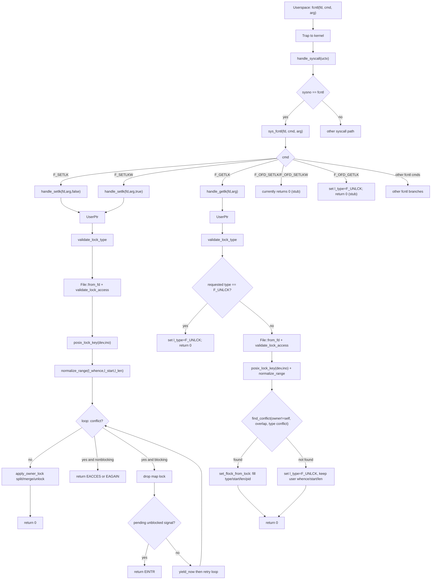
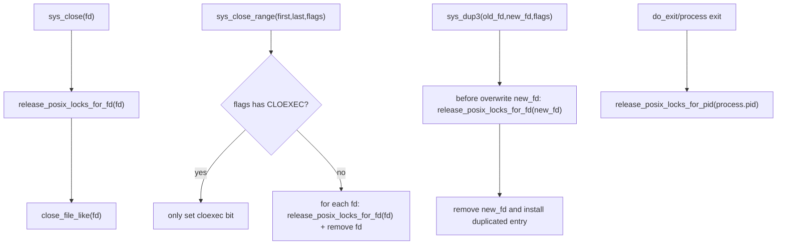
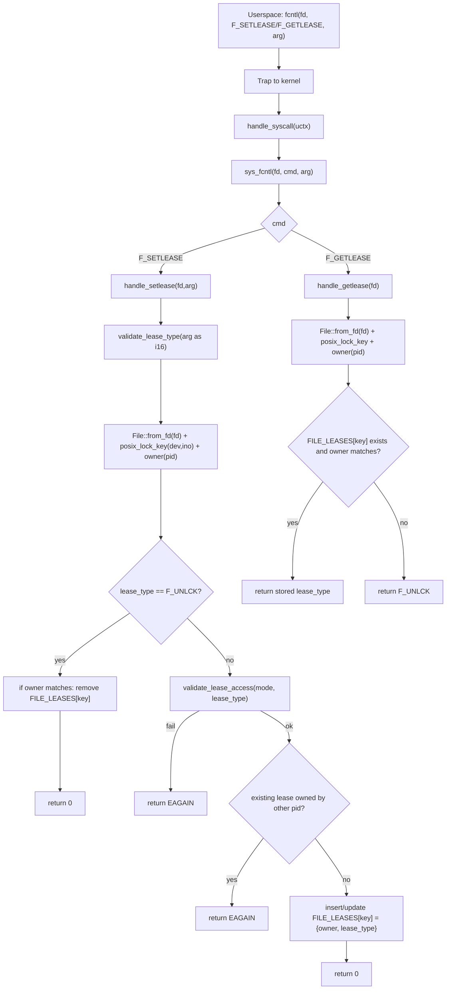
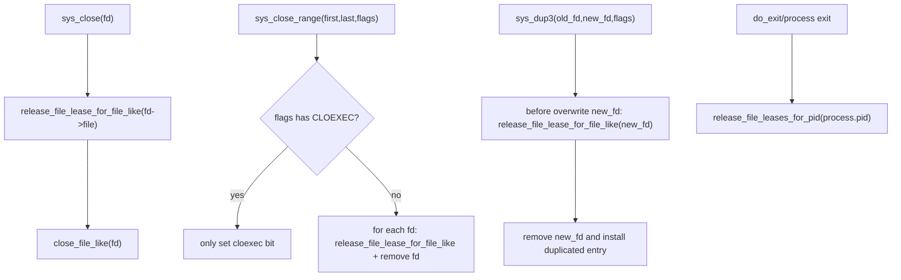

## fcntl Lock Call Flow (Current)

## POSIX Lock Release Lifecycle

## fcntl Lease Call Flow (Minimal)

Implementation notes:
- Lease state is tracked by `FILE_LEASES: BTreeMap<PosixLockKey, FileLease>`.
- `PosixLockKey` is `(dev, ino)`, so lease is inode-scoped.
- Owner is current process pid.
- Supported lease types are `F_RDLCK`, `F_WRLCK`, `F_UNLCK`.
- Access policy in minimal mode:
- `F_RDLCK` requires `O_RDONLY` fd; `O_WRONLY/O_RDWR` returns `EAGAIN`.
- `F_WRLCK` rejects `O_RDONLY` and returns `EAGAIN`.

## Lease Release Lifecycle

